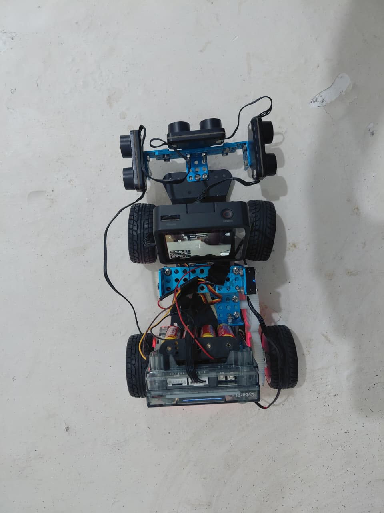
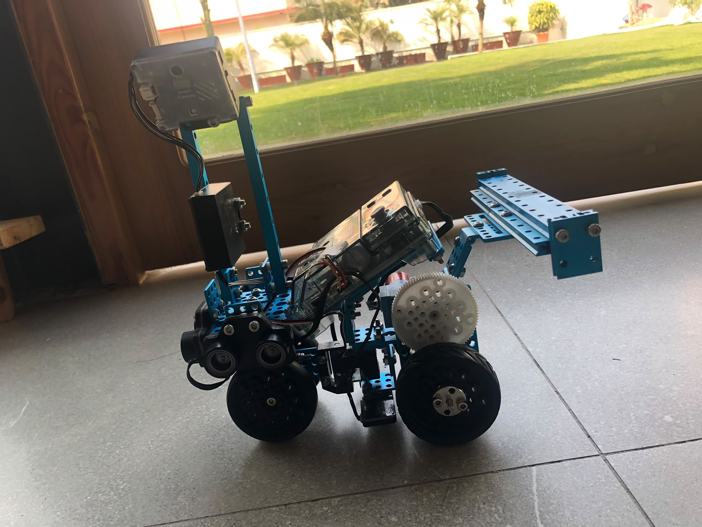
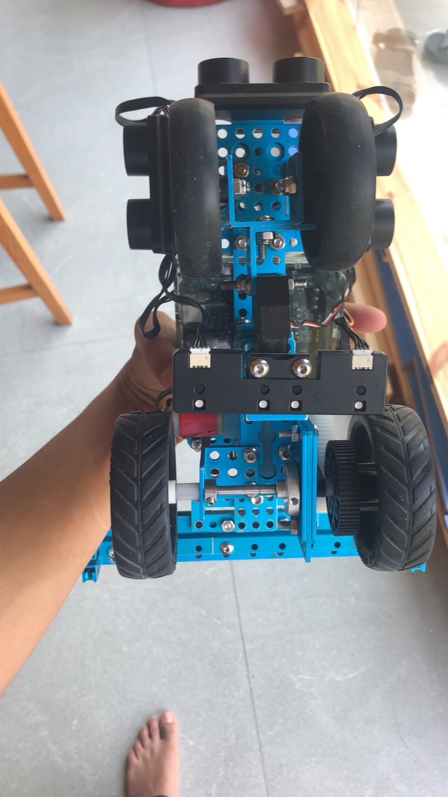
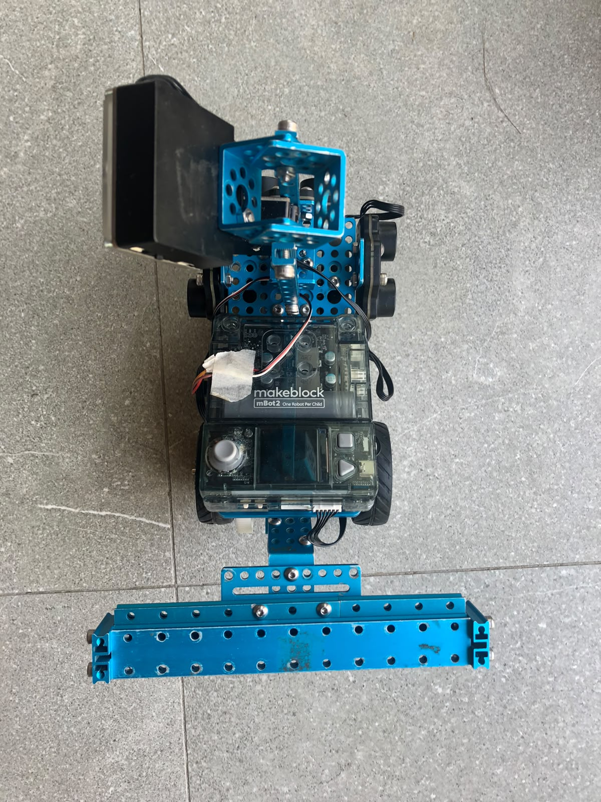

# Team Downforce | WRO Future Engineers 2026

**Karachi Grammar School · Karachi, Pakistan · Self-Driving Cars**

*Downforce V4: our custom Makeblock-based competition vehicle. Python file numbers identify programming revisions; V4 is the final physical robot.*

## Meet the team

Team Downforce is a three-member robotics team from Karachi Grammar School competing in the World Robot Olympiad Future Engineers category. We designed our vehicle to navigate the competition track autonomously, complete laps, and use visual recognition to respond to red and green traffic-sign pillars.

| Member | Responsibility |
|---|---|
| Shaayan Nadir | Documentation |
| Ziyad Farrukh | Code and design |
| Syed Taha Ahmed | Documentation and design |
| Coach | Bilal Hassan |

## Table of contents

1. [Project overview](#1-project-overview)
2. [Robot development: V1–V4](#2-robot-development-v1v4)
3. [Mobility and mechanical design](#3-mobility-and-mechanical-design)
4. [Power and electrical architecture](#4-power-and-electrical-architecture)
5. [Sensors and perception](#5-sensors-and-perception)
6. [Open and Obstacle Challenges](#6-open-and-obstacle-challenges)
7. [Software and source code](#7-software-and-source-code)
8. [Testing and engineering decisions](#8-testing-and-engineering-decisions)
9. [Parts and reconstruction](#9-parts-and-reconstruction)
10. [Photographs and performance media](#10-photographs-and-performance-media)
11. [References](#11-references)

## 1. Project overview

The project started with a YFROBOT-based platform and developed into a custom Makeblock chassis. We used the first three physical versions to explore wall sensing, steering, and reliability. Following our Nationals experience with V3, we redesigned the mechanical platform. **V4 is the final physical robot.**

Our design combines **one rear encoder drive motor**, **a shared rear axle**, **a centrally positioned servo moving both front wheels**, three ultrasonic distance sensors, an elevated Smart Camera for traffic-sign recognition, and a downward-facing Quad RGB sensor for lap counting. The integrated mBot2 system supplies all electrical power.

[Read the design and requirements overview →](docs/project-overview.md)

## 2. Robot development: V1–V4

| Physical version | Purpose | Engineering takeaway |
|---|---|---|
| **V1** | Establish basic navigation on a YFROBOT platform | Initial car-type steering and side-wall sensing |
| **V2** | Angle side ultrasonic sensors forward for earlier corner response | Angled sensing introduced unreliable readings |
| **V3** | Nationals entry with side sensors mounted orthogonally | Original platform's size and turning geometry limited obstacle maneuvering |
| **V4** | Custom Makeblock-based final design | New front linkage steering, integrated power, elevated vision and rear stabilizer |

<table><tr><td width="50%"> <em>V3: Nationals platform.</em></td><td width="50%"> <em>V4: final custom construction.</em></td></tr></table>

**Why redesign?** The V3 chassis was too bulky and could not turn tightly enough around traffic-sign pillars. The custom V4 design offered greater freedom in wheel placement, linkage geometry and component mounting.

[Read the full development history →](docs/robot-evolution.md)

## 3. Mobility and mechanical design

V4 uses a **single Makeblock 180 Optical Encoder Motor** coupled to a common rear axle, with servo-actuated steering of the two front wheels. A centrally mounted servo drives a primary lateral linkage, which connects to two side linkages. All structural connections use reusable Makeblock plates, beams, brackets and fasteners.

A further challenge was **sideways tipping during full-steering turns**. We added a rigid, approximately 200 g rear stabilizer built from metal beams, mounted across the rear of the car and behind the rear axle. This was designed around turning stability and track-wall clearance, rather than aerodynamic downforce.

*The final mechanical assembly is explained with component positions, design reasons, dimensions, calculations and build instructions in the linked chapter.*

[Read mechanical design and calculations →](docs/mechanical-design.md)

## 4. Power and electrical architecture

V4 uses a **single 3.7 V, 2500 mAh integrated lithium supply**. Unlike earlier versions that supplied the servo from a separate 6 V AA battery pack, the final vehicle powers its steering, motor, camera and sensors through the mBot2 system.

**Nominal stored battery energy:** `3.7 V × 2.5 Ah = 9.25 Wh`. Runtime calculations are presented as engineering scenarios because average whole-robot current was not directly measured.

[Read electrical architecture and runtime analysis →](docs/electrical-and-power.md)

## 5. Sensors and perception

Three Ultrasonic Sensor 2 modules cover **left, front and right** wall distances. The **front-mounted elevated Smart Camera** is dedicated to recognizing traffic-sign pillars in the Obstacle Challenge. A rear-mounted downward-facing **Quad RGB sensor** detects blue track markings for lap counting in both challenges.

[Read sensor placement and design rationale →](docs/sensors-and-perception.md)

## 6. Open and Obstacle Challenges

In the Open Challenge, the control system uses ultrasonic wall information and counts four blue-line crossings per lap. After **12 crossings** (three laps), the robot executes its finishing sequence. For the Obstacle Challenge, the Smart Camera is used to identify red and green pillars while wall sensors remain relevant to navigation.

**Competition performance:** [Watch our Open Challenge video](media/OPEN_CHALLENGE.mp4).

[Read the challenge strategies →](docs/challenge-strategies.md)

## 7. Software and source code

We progressed from mBlock experiments using gyro-based turns and acceleration/deceleration to Python approaches with wall-relative steering, nonlinear transforms, Gaussian smoothing, line counting and camera corrections.

The updated archive contains `WRO26v6.py` as its newest Python file. It is **preserved unchanged**, with documented structure and outstanding issues in the code chapter; earlier Python and mBlock versions remain in `code/history/`.

[**Read the full software documentation and code guide →**](code/README.md)

[Software flowcharts and control logic →](code/flowcharts.md)

## 8. Testing and engineering decisions

Our development process was based on diagnosing observed failures: gear separation, power-management problems, inconsistent distance readings, late corner response, excess chassis width, delayed camera updates and sideways tipping. The remedies and their limits are summarized in the engineering record.

[Read our testing, design trade-offs and results →](docs/testing-and-decisions.md)

## 9. Parts and reconstruction

The mechanical bill of materials lists the Makeblock components used in the final chassis. The accompanying assembly guide follows the bottom-up construction approach, starting with the wheel assemblies.

[Components and build guide →](docs/build-and-components.md)

## 10. Photographs and performance media

Robot photographs appear alongside the relevant design explanations, with image files organized in [`media/`](media/). The photo archive covers all four physical designs, alongside the team photo, mBlock development screenshots and Open Challenge performance footage.

- [V1 photos](media/robot_v1/) · [V2 photos](media/robot_v2/) · [V3 photos](media/robot_v3/) · [V4 photos](media/robot_v4/)
- [Open Challenge performance video](media/OPEN_CHALLENGE.mp4)

## 11. References

- [WRO 2026 season and documentation resources](https://wro-association.org/competition/2026-season/)
- [WRO Future Engineers Getting Started guide](https://world-robot-olympiad-association.github.io/future-engineers-gs/)
- [Official WRO GitHub documentation template](https://github.com/World-Robot-Olympiad-Association/wro2022-fe-template)
- [Makeblock support](https://support.makeblock.com/)

*The engineering documentation describes our actual physical robot development. Software revision filenames must not be interpreted as additional hardware versions.*

