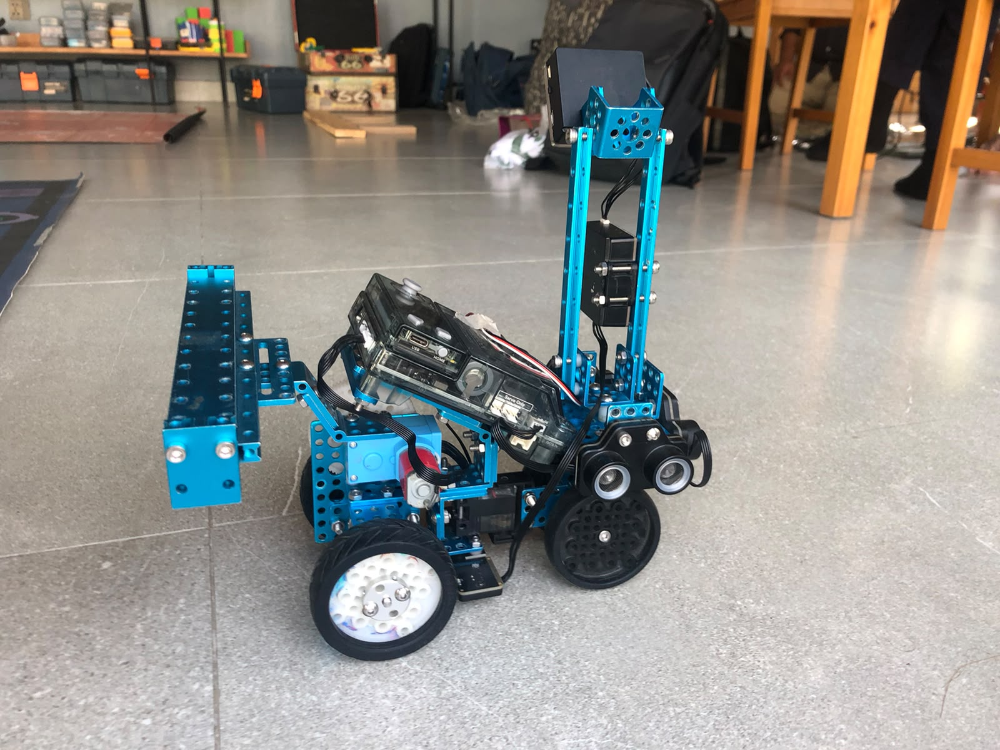
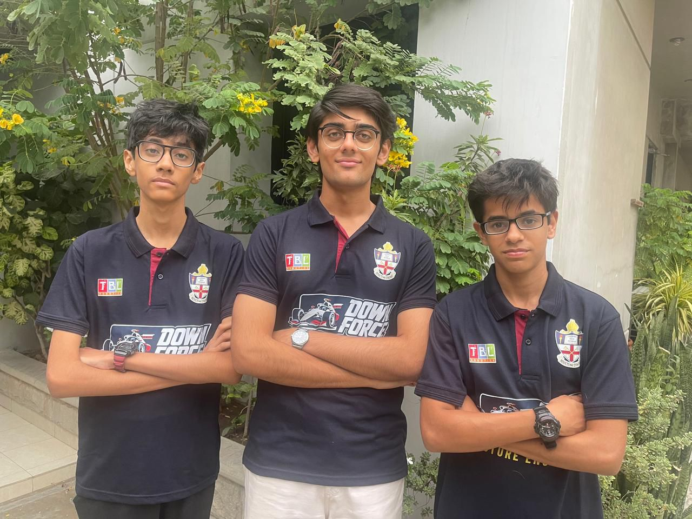
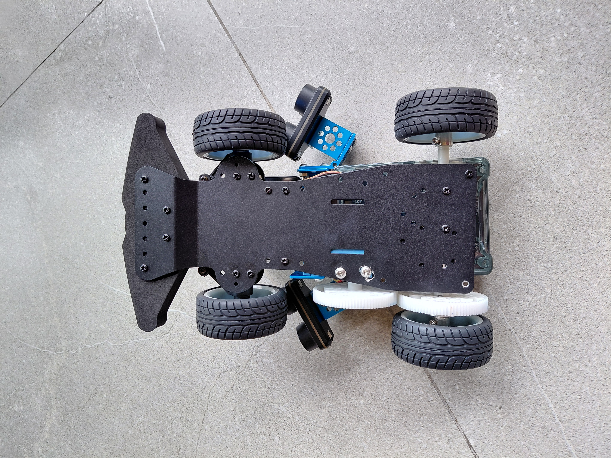
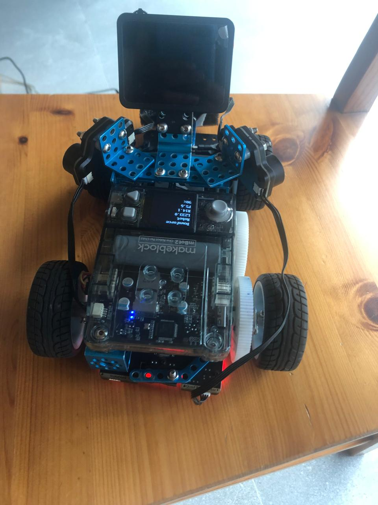
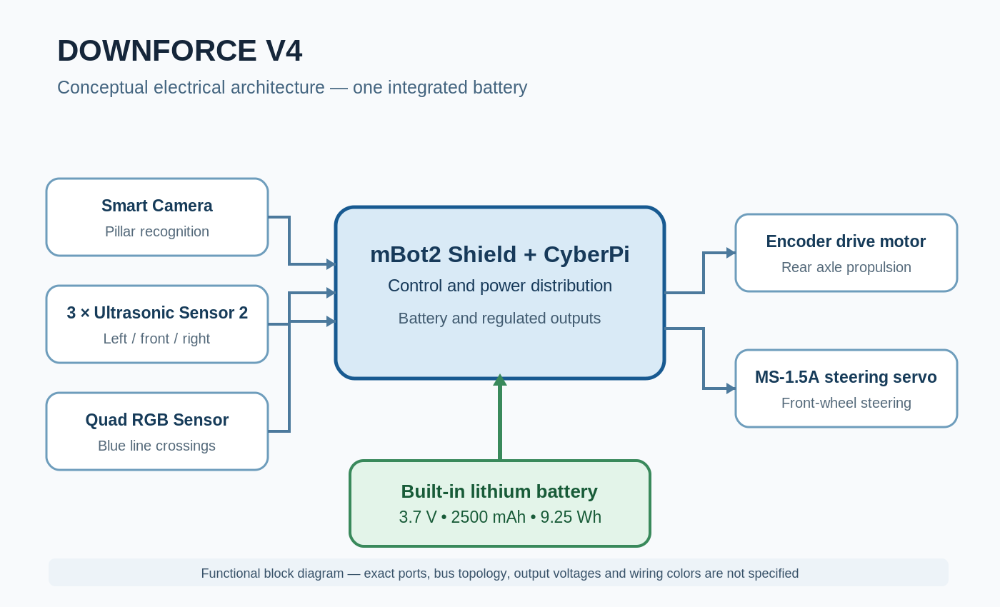
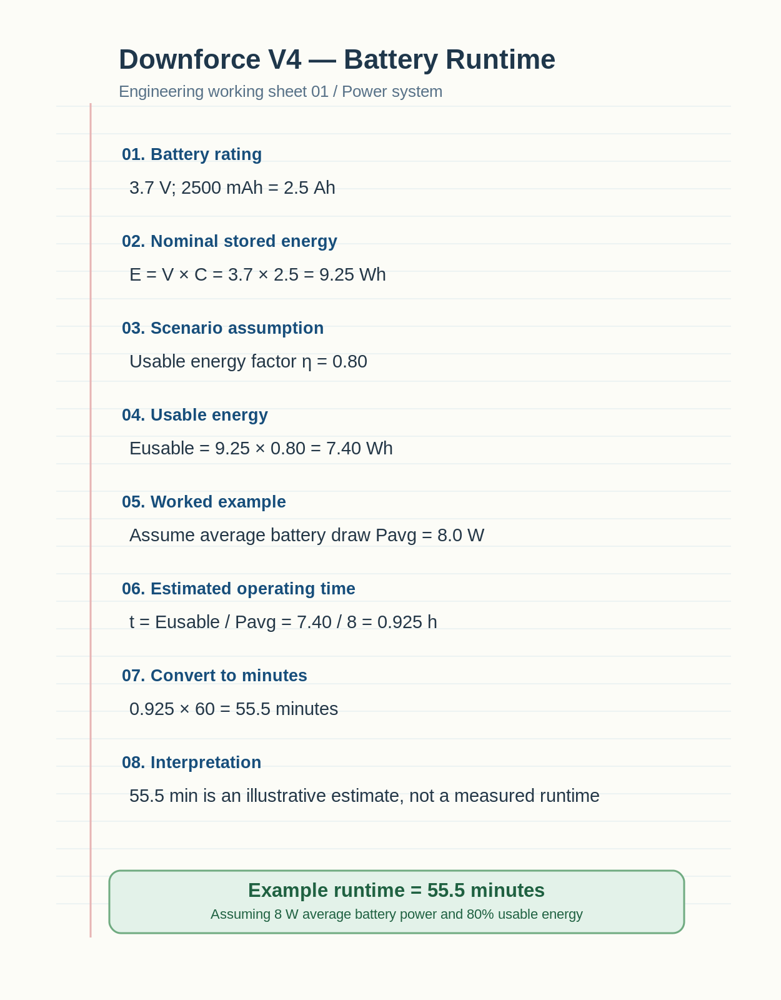
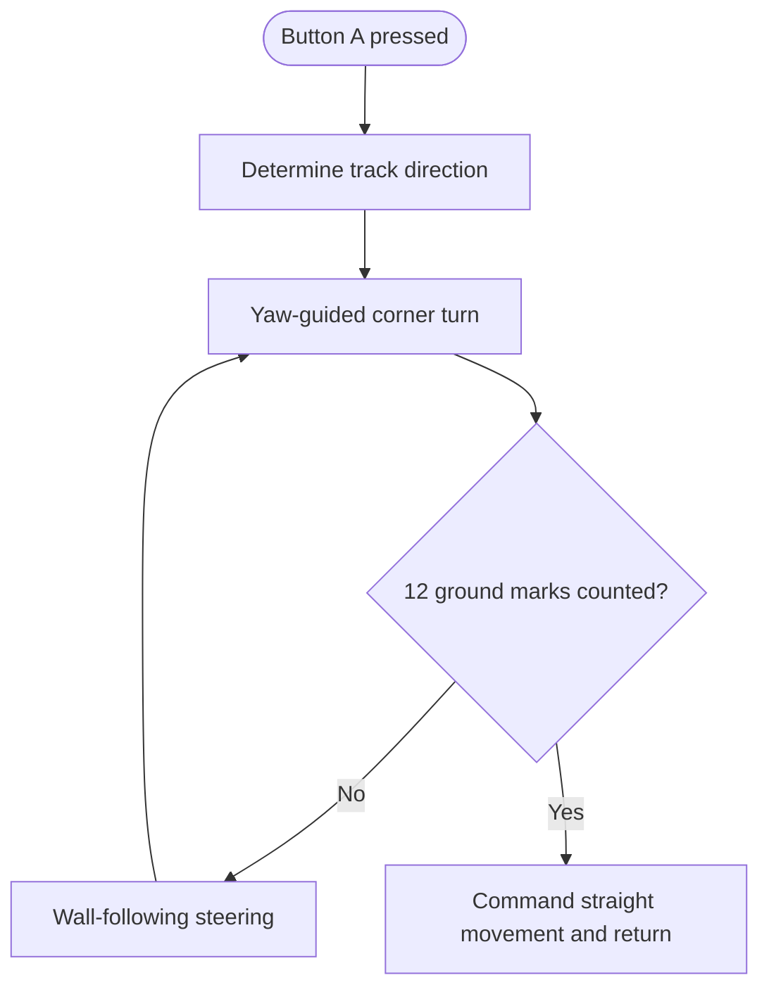

# TEAM DOWNFORCE
## WRO Future Engineers 2026 | Self-Driving Cars

**Karachi Grammar School · Karachi, Pakistan**

<p align="center"></p>
<p align="center"><em>Downforce V4 — our final custom-built Makeblock autonomous vehicle.</em></p>

We are **Team Downforce**, a three-member team from Karachi Grammar School participating in the World Robot Olympiad Future Engineers category. Our project is an autonomous car developed through four physical prototypes, combining mechanical redesign, ultrasonic navigation, color-based obstacle recognition and embedded motor control. This repository records the decisions, experiments, programs and physical components behind the car.

Our most significant development was the move from the prebuilt YFROBOT chassis used at Nationals to a custom **V4 Makeblock chassis**. The redesign addressed limitations in steering, robot dimensions, obstacle recognition and high-speed turning stability. **V4 is the final physical robot; V5 and V6 are software revision numbers only.**

<p align="center"></p>

### Our team

| Team member | Main contribution |
|---|---|
| Shaayan Nadir | Documentation |
| Ziyad Farrukh | Code and design |
| Syed Taha Ahmed | Documentation and design |
| **Coach:** Bilal Hassan | Team guidance |

---

<a id="top"></a>
## Table of Contents

1. [Project overview](#1-project-overview)
   - [The challenge](#11-the-challenge)
   - [Design philosophy](#12-design-philosophy)
   - [Final robot specifications](#13-final-robot-specifications)
   - [Robot photographs and performance video](#14-robot-photographs-and-performance-video)
2. [Engineering development: V1–V4](#2-engineering-development-v1v4)
   - [V1: initial prototype](#21-v1-initial-prototype)
   - [V2: angled ultrasonic sensors](#22-v2-angled-ultrasonic-sensors)
   - [V3: Nationals robot](#23-v3-nationals-robot)
   - [V4: custom competition robot](#24-v4-custom-competition-robot)
   - [V3 versus V4](#25-v3-versus-v4)
3. [Mobility and mechanical design](#3-mobility-and-mechanical-design)
   - [Rear-wheel drive](#31-rear-wheel-drive)
   - [Front-wheel steering](#32-front-wheel-steering)
   - [Rear stabilization spoiler](#33-rear-stabilization-spoiler)
   - [Wheel-speed calculations](#34-wheel-speed-calculations)
   - [Weight and clearance calculations](#35-weight-and-clearance-calculations)
4. [Electrical system and power management](#4-electrical-system-and-power-management)
   - [V4 power architecture](#41-v4-power-architecture)
   - [Electrical component selection](#42-electrical-component-selection)
   - [Battery capacity and runtime](#43-battery-capacity-and-runtime)
5. [Sensors and perception](#5-sensors-and-perception)
   - [Three ultrasonic sensors](#51-three-ultrasonic-sensors)
   - [Elevated Smart Camera](#52-elevated-smart-camera)
   - [Quad RGB lap-counting sensor](#53-quad-rgb-lap-counting-sensor)
6. [Navigation and challenge strategies](#6-navigation-and-challenge-strategies)
   - [Open Challenge](#61-open-challenge)
   - [Obstacle Challenge](#62-obstacle-challenge)
   - [Software navigation flowchart](#63-software-navigation-flowchart)
7. [Programming and algorithms](#7-programming-and-algorithms)
   - [Programming evolution](#71-programming-evolution)
   - [Software modules and algorithms](#72-software-modules-and-algorithms)
   - [Source code and flowcharts](#73-source-code-and-flowcharts)
8. [Testing, setbacks and design decisions](#8-testing-setbacks-and-design-decisions)
9. [Parts and building instructions](#9-parts-and-building-instructions)
10. [Documentation and repository navigation](#10-documentation-and-repository-navigation)
11. [References](#11-references)

---

## 1. Project Overview

### 1.1 The challenge

WRO Future Engineers asks teams to create a fully autonomous four-wheeled car capable of navigating a track without remote guidance. The car needs to interpret track boundaries, complete laps and respond to traffic-sign pillars in the Obstacle Challenge. Our project focuses on the engineering challenge of combining mechanical steering, propulsion, real-time sensing and software decisions on a compact mobile platform.

From early tests, we learned that reliable autonomy is not just about code. Chassis geometry determines whether a turn is physically possible; sensor placement determines what the software can see; motor response determines whether a steering command is executed predictably. Our final design reflects decisions across all three areas.

### 1.2 Design philosophy

Our development focused on five linked priorities:

| Priority | Design choice | Reason |
|---|---|---|
| Maneuverability | Custom Makeblock chassis and three-linkage steering | Reduce the cornering limitations of the Nationals car |
| Sensing consistency | Front, left and right ultrasonic sensors | Give the controller distinct measurements of surrounding walls |
| Obstacle recognition | Elevated forward Smart Camera | Provide a clearer view of red and green traffic-sign pillars |
| Stability | Rigid rear metal stabilizer | Address sideways tipping during aggressive turns |
| Simplified electronics | Single integrated mBot2 power source | Avoid a separate servo battery used on earlier versions |

### 1.3 Final robot specifications

| Specification | Downforce V4 |
|---|---|
| Physical design | Custom Makeblock beam, bracket and plate construction |
| Main controller | mBot2 / CyberPi system |
| Overall dimensions | Approx. **25 cm long × 20 cm wide × 22.5 cm high** |
| Total mass | **1.10 kg**, including rear stabilizer |
| Drive layout | Rear-wheel drive; one Makeblock 180 Optical Encoder Motor |
| Power transmission | Directly connected motor output to common rear axle |
| Steering | Front-wheel steering by one Makeblock MS-1.5A servo |
| Steering linkage | One servo-actuated central linkage connected to two wheel linkages |
| Reported steering range | Approx. 90° left and 90° right |
| Wheelbase | Approx. **21.6 cm** |
| Rear-wheel diameter | **4 in / 10.16 cm** |
| Rear-wheel thickness | **1 in / 2.54 cm** |
| Front/rear track width | Approx. **8.5 cm / 12 cm** |
| Wall distance sensors | **3** Makeblock Ultrasonic Sensor 2 modules |
| Obstacle camera | Makeblock Smart Camera, elevated at the front |
| Floor sensor | Makeblock Quad RGB sensor, near rear wheels |
| Battery | Integrated **3.7 V, 2500 mAh** rechargeable lithium supply |
| External power supply | None on V4 |

### 1.4 Robot photographs and performance video

<table>
<tr><td align="center"><br><em>Final V4 — side perspective</em></td><td align="center"><br><em>Final V4 — top layout</em></td></tr>
<tr><td align="center"><br><em>Final V4 — rear construction</em></td><td align="center"><br><em>Final V4 — sensor and camera structure</em></td></tr>
</table>

**[Watch the Open Challenge performance recording](media/OPEN_CHALLENGE.mp4)** — a recording of the robot on the track. The video is retained as direct performance evidence alongside the engineering descriptions.

[All detailed project requirements and final design choices](docs/project-overview.md)

---

## 2. Engineering Development: V1–V4

Each physical iteration was a response to limitations identified during testing. We retained the earlier robots and programs in the documentation because these failures were central to arriving at the final chassis.

### 2.1 V1: Initial prototype

Our first robot was based on a **YFROBOT car-style chassis**, with rear-wheel propulsion, servo-based steering and distance sensing. This was the starting point for learning how wheel geometry and ultrasonic feedback affected navigation. Rather than building a custom platform immediately, we used the prepared chassis to test basic driving and steering concepts.

<table><tr><td align="center"><br><em>V1 top view</em></td><td align="center"><br><em>V1 underside</em></td></tr></table>

### 2.2 V2: Angled ultrasonic sensors

A problem with the early robot was **late corner recognition**: by the time the vehicle reacted, the turn could already be difficult to complete. We experimented with angling the side ultrasonic sensors forward. This made it possible for them to see some approaching surfaces sooner, but the changed geometry also introduced frequent anomalous measurements.



The trade-off was important: *earlier* detection does not automatically mean *better* control. A sensor measuring an oblique surface may return a distance that the steering algorithm interprets incorrectly as a normal side-wall distance.

### 2.3 V3: Nationals robot

In V3, we changed the side ultrasonic layout to a more perpendicular configuration relative to the front sensor. The three-direction arrangement was easier to interpret as left, front and right wall information. **V3 was the car we took to Nationals.**

<table><tr><td align="center"><br><em>V3 sensor and chassis layout</em></td><td align="center"><br><em>V3 front arrangement</em></td></tr></table>

Nationals revealed the next set of limitations. The YFROBOT chassis was bulky for the tight turns required around pillars, and its steering range was constrained. Our team reported steering angles of about **30° left and 40° right**. We also found that the previous AI camera's updates were too slow for the response we wanted in the obstacle round.

An earlier drivetrain issue involved separation between a motor gear and axle gear. During development, we used a rubber-band retention workaround to keep the gears engaged.


These experiences motivated a larger redesign: a different chassis and different camera, not simply another software parameter adjustment.

### 2.4 V4: Custom competition robot

For the final physical robot, we stopped relying on the prebuilt YFROBOT chassis. Instead, we assembled a custom frame from **Makeblock aluminum structural pieces, brackets, plates, nuts and screws**. The build began at the wheel assemblies and continued upward to the controller and sensor mounts.


The new layout allowed a centrally positioned front steering servo, custom left/right steering linkages, shared rear-axle propulsion, an inclined controller mount, and a front-mounted raised Smart Camera. We retained the left/front/right ultrasonic arrangement from the preceding development stage. Later, we added a rear stabilization structure to address sideways tipping at higher speeds.

### 2.5 V3 versus V4

| Mechanical or system feature | V3 — Nationals | V4 — Final robot |
|---|---|---|
| Main structure | Prebuilt YFROBOT | Custom assembled Makeblock chassis |
| Steering | Earlier Ackermann arrangement | Servo-driven lateral three-linkage mechanism |
| Reported left/right steering | 30° / 40° | 90° / 90° |
| Robot mass | **0.91 kg** | **1.10 kg** including stabilizer |
| Camera | XTOOL Education AI Camera 2.0 | Makeblock Smart Camera |
| Power arrangement | External 6 V AA servo pack in earlier setup | Integrated mBot2 source only |
| Main challenge | Turning constraints, obstacle response | Stability and optimized system integration |

The V3–V4 transition represents an engineering choice to gain control over the geometry and component layout rather than accept the constraints of a ready-made chassis. It also meant adding structural mass and more assembly work, a trade-off that is reflected in the weight comparison below.

[Read the complete V1–V4 development history](docs/robot-evolution.md)

---

## 3. Mobility and Mechanical Design

### 3.1 Rear-wheel drive

The robot uses **one Makeblock 180 Optical Encoder Motor** to power the two rear wheels through a shared axle. The motor output connects directly to the axle, with the motor's reduction gearing contained inside the motor assembly. The front wheels are not driven: their job is steering.


**Why a single motor?** One motor with a shared axle simplifies actuation, wiring and speed commands compared with driving each rear wheel separately. It also introduces a limitation: without an axle differential, both rear wheels share the same rotational motion even though the outside wheel travels a longer path in a corner. That can produce tire scrubbing in tight turns.

### 3.2 Front-wheel steering

A **Makeblock MS-1.5A servo** is mounted centrally underneath the tilted controller, behind the front wheels. Its output actuates one central metal linkage that moves sideways. Two further linkages connect it to the left and right front-wheel pivots. One actuator thus coordinates both front wheels.


**Why this placement?** The servo is protected within the chassis and positioned between the wheels for a compact, approximately symmetrical mechanism. Makeblock beams and screw/nut fasteners give the linkage a rigid overall structure while allowing the joints needed for steering motion. The team tightened the fasteners securely and did not report persistent loosening during tests.

The reported V4 wheel-steering capability is approximately ±90°, compared with 30° left and 40° right for V3. **Steering angle should not be confused with turning radius**: the actual driven path at extreme angles depends on the linkage, wheel grip and the shared rear axle.

### 3.3 Rear stabilization spoiler

One of V4's most useful design changes followed an observed failure. At full steering, the robot could **tip sideways above roughly 2 km/h**. We added a rigid metal structure behind the rear axle, assembled by fastening multiple Makeblock beams together. The team calls this structure the **rear spoiler**; its principal role in our design is mechanical stabilization rather than aerodynamic downforce.


| Spoiler characteristic | Value |
|---|---:|
| Left-to-right span | **20 cm** |
| Front-to-back depth | **2.5 cm** |
| Vertical section height | **2.5 cm** |
| Lowest point above mat | **11 cm** |
| Upper edge above mat | Approximately **13.5 cm** |
| Mass | Approximately **200 g** |
| Location | Behind rear wheels, across the width of chassis |
| Fastening | Rigid, multiple screwed-together metal Makeblock beams |

**Why this arrangement?** A fixed rear mass changes the distribution of load through the chassis; fastening the beams rigidly prevents the assembly itself from swinging during sudden turns. Its side-to-side span and position also meant that the mounting height had to clear inner and outer competition walls. The team reports full-steering stability at approximately **4 km/h** following this modification.

### 3.4 Wheel-speed calculations

The rear-wheel diameter is **4 inches**. Converting to metric units:

\[
D=4(2.54)=10.16\text{ cm}=0.1016\text{ m}
\]

Wheel circumference:

\[
C=\pi D=\pi(0.1016)=0.3192\text{ m}
\]

If the wheel turns at the motor output-shaft speed, estimated linear velocity is:

\[
v=\frac{C\times N\times60}{1000}\quad (\text{km/h when } C \text{ is in metres and } N \text{ in rpm})
\]

| Motor output condition | RPM | Ideal speed |
|---|---:|---:|
| Rated-load output | 178 | **3.41 km/h** |
| No-load output | 350 | **6.70 km/h** |

These ideal estimates describe wheel movement at the given rotational speeds. Actual track speed depends on rolling conditions, loading and motor commands.

### 3.5 Weight and clearance calculations

**Robot mass comparison:**

\[
\Delta m=1.10-0.91=0.19\text{ kg}=190\text{ g}
\]

\[
\%\text{ mass increase}=\frac{0.19}{0.91}\times100=\boxed{20.9\%}
\]

**Spoiler fraction of V4 mass:**

\[
\frac{0.20}{1.10}\times100=\boxed{18.2\%}
\]

**Static wall clearance:** With a 10 cm track wall and the spoiler's lowest part at 11 cm above the mat, the nominal static clearance is:

\[
C=11-10=\boxed{1\text{ cm}}
\]

**Turning stability comparison:**

\[
\frac{4-2}{2}\times100=\boxed{100\%\text{ increase in reported stable turning speed}}
\]

At equal turn radius, lateral acceleration follows \(a=v^2/R\). Doubling speed requires four times the lateral acceleration, illustrating why the higher-speed cornering problem was significant. The spoiler's effect depends on the complete center of mass and wheel contact geometry; the team's observed before-and-after result is the practical evidence for the modification.

[Detailed mobility design, steering explanation and assembly calculations](docs/mechanical-design.md)

---

## 4. Electrical System and Power Management

### 4.1 V4 power architecture

In the earlier chassis revisions, a **separate 6 V power pack made from four AA batteries** was used for the steering servo. This followed earlier steering power and overheating difficulties. In V4, every electrical device receives its supply through the mBot2 integrated system. There is **no external battery pack** on the final car.



The single-source architecture removes separate charging and battery mounting requirements. On the other hand, the drive motor, servo, controller, camera and sensors share one battery, so changes in driving and steering load affect total power demand.

### 4.2 Electrical component selection

| Component | Quantity | Function in the robot |
|---|---:|---|
| mBot2 Shield / CyberPi control system | 1 | Main program execution, inputs, actuation control and power distribution |
| 180 Optical Encoder Motor | 1 | Drives the shared rear axle |
| MS-1.5A servo | 1 | Controls front-wheel linkage steering |
| Ultrasonic Sensor 2 | 3 | Front, left and right ranging |
| Makeblock Smart Camera | 1 | Detects red and green pillars for obstacle navigation |
| Quad RGB sensor | 1 | Reads blue floor markings for lap counting |
| Integrated lithium battery | 1 | Supplies entire system, 3.7 V / 2500 mAh |

### 4.3 Battery capacity and runtime

Battery capacity is **2500 mAh = 2.5 Ah** at nominal **3.7 V**, giving:

\[
E=V\times C=3.7\times2.5=\boxed{9.25\text{ Wh}}
\]



For a power-budget scenario, the electrical chapter uses average modeled loads for the controller, drive motor, servo, ultrasonics, camera and RGB sensor. These give **6.75 W of component-side power**. With an assumed **85% distribution efficiency**, battery-side demand is approximately **7.94 W**. If **80% of the nominal stored energy** is assumed available, then:

\[
E_{use}=9.25\times0.80=7.40\text{ Wh}
\]

\[
t=\frac{7.40}{7.94}=0.932\text{ h}=\boxed{55.9\text{ minutes}}
\]

This is a calculated battery-runtime scenario; driving pattern, battery condition, motor load and power conversion affect actual endurance. The Smart Camera remains powered during both competition challenges, even when its obstacle-recognition function is not being used.

[Electrical design, component power-budget assumptions and further runtime cases](docs/electrical-and-power.md)

---

## 5. Sensors and Perception

A navigation algorithm is only as useful as the measurements it receives. Downforce V4 distributes sensing tasks across ultrasonic modules, a forward Smart Camera and a downward-facing RGB sensor rather than relying on one sensor for everything.

### 5.1 Three ultrasonic sensors

The car uses **three Makeblock Ultrasonic Sensor 2 modules** looking left, forward and right. The front module gives information about upcoming walls; the two side modules supply track-relative distance information for steering. The layout was refined after the V2 angled side sensors produced unreliable measurements for the algorithm.

<table><tr><td align="center"><br><em>V2 forward-angled arrangement</em></td><td align="center"><br><em>V3 orthogonal sensing concept</em></td></tr></table>

The original project documentation describes a nominal 5–300 cm sensing range and an error figure of about ±5%. In practice, the surface angle and reflected signal affect what an ultrasonic sensor measures; this helps explain why the angled arrangement did not consistently behave as intended.

### 5.2 Elevated Smart Camera

The **Makeblock Smart Camera** is mounted high at the front of V4. It is used for **traffic-sign pillar recognition in the Obstacle Challenge**, not normal wall following. The elevated position provides an unobstructed forward view and more opportunity to identify a pillar before approaching too closely.


At Nationals, the team's preceding AI camera provided obstacle updates too slowly for the desired navigation response. We therefore changed the camera and its mounting approach in V4. The new mount trades compactness for forward visual clearance and early recognition.

### 5.3 Quad RGB lap-counting sensor

Near the rear-wheel assembly, a **downward-facing Makeblock Quad RGB sensor** reads blue markings on the mat. These provide a simple reference for completing the prescribed laps in both Open and Obstacle Challenge navigation.

\[
4\text{ blue crossings/lap}\times3\text{ laps}=\boxed{12\text{ crossings}}
\]

The sensor is placed at the rear so the front of the vehicle passes over a marking before its passage is registered. It also stays clear of the forward steering linkage. The team's described sequence continues approximately **3–4 seconds** after the twelfth marking before stopping; the exact button, line-processing and stopping implementations are explored in the software chapter.

[Sensor positions, selection rationale and sensing limits](docs/sensors-and-perception.md)

---

## 6. Navigation and Challenge Strategies

### 6.1 Open Challenge

The Open Challenge requires the vehicle to navigate using track geometry without traffic-sign pillars. Downforce's development used left/right ultrasonic information to form steering corrections, with a front range sensor helping detect approaching end walls. The Quad RGB sensor is used to track blue floor markings through the laps.

**Sequence of the team's documented Open Challenge concept:**

1. Start autonomous driving.
2. Read front/left/right wall distances.
3. Calculate steering according to the current algorithm.
4. Identify corners and apply corresponding control behavior.
5. Detect successive blue ground markings at the rear sensor.
6. After the three-lap count, execute the final stopping maneuver.


**[Open Challenge demonstration video](media/OPEN_CHALLENGE.mp4)**

### 6.2 Obstacle Challenge

The Obstacle Challenge adds colored traffic-sign pillars. Downforce's obstacle approach uses the Smart Camera to classify red and green pillars and adjust steering, while ultrasonics remain useful for understanding the track boundaries.

The archived **Python V5** source contains an obstacle-related function that uses camera-detected horizontal position and object height to calculate a steering correction, with the direction of correction dependent on pillar color. This historical program is kept separate from the newer V6 navigation file: a *software revision number* is not a physical robot version.


[Challenge explanations and control strategy notes](docs/challenge-strategies.md)

### 6.3 Software navigation flowchart

GitHub renders the following diagram directly from editable Mermaid syntax:



*This diagram summarizes the state-based navigation branch in Python V6; historical V5 Open and Obstacle routines are diagrammed separately.*

[View all seven software flowcharts](code/flowcharts.md)

---

## 7. Programming and Algorithms

### 7.1 Programming evolution

The development began with graphical **mBlock** programs, then moved through several Python implementations. Each revision focused on a different part of autonomous control: steering response, smoothing, line counting, challenge-specific behavior or navigation states.

| Program | Development focus |
|---|---|
| `S2_11.4.mblock` | Ultrasonic and gyro navigation experiments |
| `S3_18.4.mblock` | Speed transitions / acceleration and deceleration |
| `S4_25.4.mblock` | Gyroscope relative-turn control |
| `WRO26v1.py` | Earlier ultrasonic wall steering |
| `WRO26v2.py` | Nonlinear steering response |
| `WRO26v3.py` | RGB line-count target |
| `WRO26v4.py` | Gaussian-weighted steering smoothing |
| `WRO26v5.py` | Open/Obstacle functions and camera correction |
| `WRO26v6.py` | Newer state-based navigation and line-counting architecture |


### 7.2 Software modules and algorithms

The software documentation explains the following concepts directly from the archived source:

**Wall-relative steering.** Left and right ultrasonic readings provide an error signal used to set front-wheel steering. Earlier revisions explored a nonlinear response to avoid strong corrections for small distance errors.

**Gaussian steering smoothing.** Older Python revisions use a short history of steering commands and a weighted average to reduce abrupt changes from individual sensor readings. Smoothing reduces jitter but adds response lag — a trade-off during tight cornering.

**Direction and corner states.** The newer V6 script uses functions that identify track direction, perform a yaw-guided turn and compute wall-following corrections. The flowcharts show transitions between the named states.

**Lap counting.** RGB sensor events register floor markings; repeated readings of the same line must be distinguished from a new crossing. The flowchart chapter documents the events and counter states represented in the archived programs.

**Camera-guided obstacle adjustments.** The archived V5 program contains camera-based obstacle corrections. Those routines are explained as part of software development history rather than being attributed to every revision.

### 7.3 Source code and flowcharts

- **[Complete software README — functions, math and code explanations](code/README.md)**
- **[Seven editable software flowcharts](code/flowcharts.md)**
- **[Newest archived Python file: WRO26v6.py](code/latest-submitted/WRO26v6.py)**
- **[Historical source code and mBlock projects](code/history/)**

The main README provides the system-level overview; the separate software README contains the function-level explanation so that a reader can follow the program without searching through images of code.

---

## 8. Testing, Setbacks and Design Decisions

An engineering design becomes meaningful when the reasons behind its changes are visible. Our project history includes several problems that changed how we built or programmed the car.

| Development issue | Change made | Engineering lesson |
|---|---|---|
| Early drive gears disengaged | Rubber-band retention workaround | Mechanical engagement must remain secure under drive loading |
| Servo overheating or underpowered behavior in earlier versions | External 6 V AA servo supply | Actuators may need a different power arrangement from control electronics |
| Jerky acceleration/deceleration | mBlock speed-ramping experiments | Sudden drive transients can destabilize the robot |
| Late corner response | Forward-angle ultrasonic test in V2 | Earlier detection is valuable only when measurements remain interpretable |
| Anomalous angled readings | Side sensor reorientation in V3 | Sensor geometry and software assumptions must match |
| Excessive size / turning limitations at Nationals | New Makeblock V4 chassis | Mechanical limitations cannot always be corrected in software |
| Camera updates too slow for obstacle response | Change to Smart Camera | Perception response time matters during moving avoidance |
| Sideways tipping at full steering | Rigid rear stabilizer | Weight placement, turning speed and wall clearance interact |
| Abrupt steering commands | Nonlinear correction and smoothing experiments | Filtering improves smoothness but can introduce lag |

### Quantified changes

| Measure | Earlier design / condition | Later design / condition |
|---|---:|---:|
| Physical robot weight | V3: 0.91 kg | V4: 1.10 kg |
| Reported left/right steering range | V3: 30° / 40° | V4: 90° / 90° |
| Stable full-steering speed | Before stabilizer: around 2 km/h threshold | After stabilizer: around 4 km/h |
| Electrical power sources | Separate servo pack on earlier robots | One integrated source on V4 |

The final result is not the product of a single change. It reflects the combined development of steering geometry, motor control, sensor positions, camera selection and chassis stability.

[Full testing and engineering decision record](docs/testing-and-decisions.md)

---

## 9. Parts and Building Instructions

Our final chassis uses modular Makeblock structural pieces rather than a custom-machined body. This lets the steering, drive and camera support systems be mounted to a common set of beams and brackets.

### Makeblock structural bill of materials

| Structural component | Quantity |
|---|---:|
| 3×3 L-Bracket | 6 |
| Bracket U1 | 4 |
| V-Bracket | 3 |
| 3×8 L-Bracket | 1 |
| 7×9 Plate | 1 |
| 3×9 Plate | 3 |
| 1×17 Beam | 2 |
| 3×22 Beam | 1 |
| 3×8 Beam | 1 |
| 3×14 Beam | 1 |
| 3×4 Beam | 2 |
| **Total** | **25** |

### Reconstructing the vehicle

The documented construction follows a **bottom-up approach**. Establish the front and rear wheel assemblies and a common wheelbase, then join them with the Makeblock beams and brackets. Mount the centrally located steering servo and three-linkage assembly, connect the rear encoder motor to its shared axle, attach the controller and sensor supports, and finally install the rigid rear spoiler. Check steering travel and cable clearance before running the vehicle.


[Full component inventory and construction guide](docs/build-and-components.md)

---

## 10. Documentation and Repository Navigation

The main README is the entry point to the project. Every technical chapter contains additional details, photographs, mathematics and reasoning relevant to its subsystem.

| Document | Contents |
|---|---|
| [Project overview](docs/project-overview.md) | Design objectives and final system |
| [Robot development](docs/robot-evolution.md) | Complete V1–V4 chronology and photographs |
| [Mechanical design](docs/mechanical-design.md) | Chassis, steering, drivetrain, spoiler, calculations |
| [Electrical and power](docs/electrical-and-power.md) | Battery, architecture and runtime |
| [Sensors and perception](docs/sensors-and-perception.md) | Ultrasonic, vision and RGB arrangements |
| [Challenge strategies](docs/challenge-strategies.md) | Open and Obstacle Challenge approaches |
| [Software README](code/README.md) | Algorithms, function descriptions and file index |
| [Software flowcharts](code/flowcharts.md) | Seven editable Mermaid diagrams |
| [Testing and decisions](docs/testing-and-decisions.md) | Failures, improvements and performance evidence |
| [Components and build](docs/build-and-components.md) | Structural quantities and reconstruction procedure |
| [Open Challenge video](media/OPEN_CHALLENGE.mp4) | Autonomous performance recording |

### Repository organization

```text
Downforce/
├── README.md
├── docs/
│   ├── project-overview.md
│   ├── robot-evolution.md
│   ├── mechanical-design.md
│   ├── electrical-and-power.md
│   ├── sensors-and-perception.md
│   ├── challenge-strategies.md
│   ├── testing-and-decisions.md
│   └── build-and-components.md
├── code/
│   ├── README.md
│   ├── flowcharts.md
│   ├── latest-submitted/WRO26v6.py
│   └── history/
├── hardware/
│   ├── diagrams/
│   └── calculations/
├── media/
│   ├── robot_v1/ ... robot_v4/
│   └── OPEN_CHALLENGE.mp4
└── screenshots/
```

---

## 11. References

- [Official WRO 2026 season resources](https://wro-association.org/competition/2026-season/)
- [WRO Future Engineers Getting Started guide](https://world-robot-olympiad-association.github.io/future-engineers-gs/)
- [Official WRO documentation template](https://github.com/World-Robot-Olympiad-Association/wro2022-fe-template)
- [Makeblock technical support](https://support.makeblock.com/)

---

<p align="right"><a href="#top">Back to top ↑</a></p>
