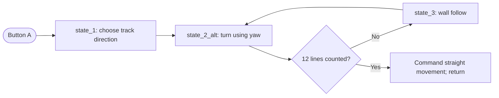

# 7. Software Architecture, Algorithms and Code Development

[← Main README](../README.md)

## Overview

The Downforce repository contains early mBlock programs and Python revisions. We keep the **original files unchanged** so the engineering progression is inspectable. Physical robot V4 is the only final hardware version; software filenames (`WRO26v5.py`, `WRO26v6.py`) are revision numbers, not physical robots.

The repository documents **Python V6 navigation and line counting**, as well as the **earlier V5 Open and Obstacle Challenge algorithms**. The two revisions are discussed independently to make their development and control logic easy to follow.

## Visual software flowcharts

**[Open all seven annotated algorithm flowcharts](flowcharts.md)** — includes the newest V6 navigation and line-counting control flow, plus separately identified historical V5 Open/Obstacle routines. The diagrams are native GitHub Mermaid blocks, so they render automatically and remain editable.

### V6 navigation at a glance



*Overview of the V6 navigation branch. The line-counting event handler is diagrammed separately in the flowchart chapter.*

## Software table of contents

1. [File index and evolution](#1-file-index-and-evolution)
2. [Input and output devices](#2-input-and-output-devices)
3. [Architecture of the newest WRO26v6.py](#3-architecture-of-the-newest-wro26v6py)
4. [Wall-following and steering mathematics](#4-wall-following-and-steering-mathematics)
5. [Corner and directional logic](#5-corner-and-directional-logic)
6. [Lap counting](#6-lap-counting)
7. [Historical camera obstacle management](#7-historical-camera-obstacle-management)
8. [Smoothing and development choices](#8-smoothing-and-development-choices)
9. [Buttons, errors and software risks](#9-buttons-errors-and-software-risks)
10. [Reproducing the environment](#10-reproducing-the-environment)
11. [Algorithm flowcharts](flowcharts.md)

## 1. File index and evolution

| File | Engineering focus |
|---|---|
| [`S2_11.4.mblock`](history/S2_11.4.mblock) | Early ultrasonic navigation and gyroscope experiments |
| [`S3_18.4.mblock`](history/S3_18.4.mblock) | Acceleration and deceleration in straight sections |
| [`S4_25.4.mblock`](history/S4_25.4.mblock) | Gyro-based 90° relative turning |
| [`WRO Drive_controller.mblock`](history/WRO%20Drive_controller.mblock) | Earlier drive-controller project |
| [`WRO26v1.py`](history/WRO26v1.py) | Initial wall-relative ultrasonic steering |
| [`WRO26v2.py`](history/WRO26v2.py) | Nonlinear steering response refinement |
| [`WRO26v3.py`](history/WRO26v3.py) | 12-marking lap target and RGB detection |
| [`WRO26v4.py`](history/WRO26v4.py) | Gaussian-weighted command smoothing |
| [`WRO26v5.py`](history/WRO26v5.py) | Separate Open/Obstacle functions, vision correction, timed finish |
| [`WRO26v6.py`](latest-submitted/WRO26v6.py) | Newer state-driven corner and wall logic, direction selection and line counter |


*Early graphical programming remained an important part of algorithm development; the screenshots are preserved alongside source files rather than treated as the final executable program.*

## 2. Input and output devices

| Device | Software function |
|---|---|
| Three ultrasonic modules | Track-distance readings and corner recognition |
| Quad RGB sensor | Blue line or ground-mark crossing detection |
| Smart Camera | Color/pillar detection in the historical Obstacle Challenge Python V5 |
| Rear encoder motor | Drive command |
| Steering servo | Front wheel steering angle command |
| CyberPi display, buttons, LEDs and IMU | Input, status, testing and corner feedback in different revisions |

**Sensor port caution:** Python revisions V3–V5 use left=1, front=2, right=3; **V6 reverses the side mapping** to left=3, front=2, right=1. The live wiring must match whichever script is used.

## 3. Architecture of the newest WRO26v6.py

The newest source uses named constants, multiple navigation functions, and button-triggered events:

```python
LEFT_SENSOR = 3
FRONT_SENSOR = 2
RIGHT_SENSOR = 1
DETECTION_DISTANCE = 120
FRONT_STOP_DISTANCE = 50
spd = 50
str_ang = 90
ang_range = 40
```

These are the values defined in Python V6. The program uses `state_1`, `state_2`, `state_2_alt`, `state_3`, `state_3_alt`, `calc_angle` and a separate `line()` function. It does **not** show the same Open/Obstacle function split as V5.

```text
Button A
  ├─ state_1: select direction from side openings
  └─ repeat
       ├─ state_2_alt: execute gyroscope-guided corner
       ├─ check whether lap count reached 12
       └─ state_3: follow side wall toward next corner

Separate Button A line() handler:
  └─ count threshold transitions from Quad RGB sensor

Button B:
  └─ stop motor; center steering; reset yaw and lap count
```

**Why split the states?** It makes direction selection, cornering and straight-wall control easier to reason about and adjust independently rather than hiding them in one large loop.

## 4. Wall-following and steering mathematics

The newest code includes the following steering conversion:

```python
def calc_angle(dl, dr):
    Q = max(dl / dr, dr / dl) * sgn(dl - dr)
    Q -= sgn(Q)
    R = math.tanh((Q**p * sgn(Q)) / k)
    R = str_ang + ang_range * R
    return R
```

Here `dl` and `dr` are left and right distances, `str_ang = 90` is the nominal straight steering command, `ang_range = 40` bounds the intended correction size, and `math.tanh()` limits response as asymmetry increases. In the newest source `p=2`, `k=1`.

**Design reasoning:** A bounded nonlinear function can be less abrupt around balanced wall readings and can avoid arbitrarily large servo demands when the distance ratio grows. This is an explanation of the function's mathematical effect, not proof that the code has been tuned optimally.

Because the formula divides by `dl` and `dr`, a zero reading can cause division by zero. The earlier programs use additional range filtering; this is an important control-system design distinction.

## 5. Corner and directional logic

### `state_1()` — finding track orientation

The car initially drives with the steering centered and waits until either side sensor detects an opening above `DETECTION_DISTANCE = 120`. It then assigns a `dir` flag (`-1` or `+1`) and selects `oppsensor` and `mainsensor` for subsequent navigation.

### `state_2_alt()` — yaw-guided turn

The function resets CyberPi yaw, commands servo offset by `30 * dir`, then watches the reported yaw angle until it crosses a direction-dependent threshold of approximately ±60° before straightening. An earlier `state_2()` instead uses a timed `mbot2.forward(50, 1.8)` turn.

### `state_3()` — wall-following correction

The robot follows `oppsensor` distance toward a target band around **25–27.5 cm**. Correction is in steps of **±5° or ±10°**, depending on measured wall distance. The phase ends as the front sensor falls below `FRONT_STOP_DISTANCE = 50`.

These are source-level thresholds. Units and behavior rely on the relevant Makeblock API definitions and physical calibration.

## 6. Lap counting

The historical V3 and V5 code and the team's described method count **four blue line crossings per lap**, giving **12 for three laps**. In V6 the `line()` handler waits for the Quad RGB status to change from nonzero to zero, then waits for it to leave zero, incrementing `sublevel` once per transition.

```python
while sublevel < 12:
    while mbuild.quad_rgb_sensor.get_line_sta('all', 1) != 0:
        pass
    while mbuild.quad_rgb_sensor.get_line_sta('all', 1) == 0:
        pass
    sublevel += 1
```

**Why use two waits?** This is an edge/release approach: a long mark should not be counted repeatedly as separate marks while the sensor stays over it. The loops wait for a marking-entry and marking-exit transition; sensor faults can hold the routine in a wait state.

V6 registers separate Button A handlers for navigation and line detection. The source also contains an indentation error around the console-display statements in `line()`, which interrupts Python parsing. The archive retains the original revision for traceability.

## 7. Historical camera obstacle management

`WRO26v5.py` contains an `obst()` function that reads the Smart Camera's apparent object position and size. Its algorithm generates a position-dependent target horizontal coordinate and applies a proportional correction to wall-relative steering:

```python
error = target_x - x
camera_correction = error * 0.25
```

The historical code chooses the correction's sign based on the camera's detected color and returns to the smoothed steering command. This was an attempt to combine colored-pillar avoidance with existing ultrasonic control. This camera-correction algorithm belongs to **Python V5** and is not part of the V6 navigation script.

The V5 revision selects between `open()` and `obst()` using a front-distance condition. This illustrates the earlier approach to challenge selection.

## 8. Smoothing and development choices

V4 and V5 Python revisions use Gaussian-weighted smoothing of a recent history of steering commands:

\[
w_i=\exp\left(-\frac{d_i^2}{2\sigma^2}\right),\qquad
\theta_{smooth}=\frac{\sum_i w_i\theta_i}{\sum_i w_i}
\]

| Revision | History length | Sigma |
|---|---:|---:|
| Python V4 | 5 samples | 1.625 |
| Python V5 | 6 samples | 3 |

This suppresses some abrupt changes but can delay response to new corners. The V6 state-driven algorithm takes a different approach.


## 9. Buttons, errors and software risks

**Button A:** Initiates navigation in V6; a second Button A event is also registered to count line crossings.

**Button B:** Stops encoder motor, centers steering, resets yaw and resets `sublevel`.

**Up key:** Initiates a diagnostic display of the three ultrasonic readings.

## V6 implementation details

1. Indentation/syntax problem in the `line()` function.
2. Two Button A decorators that may have event/concurrency implications.
3. Busy loops without timeouts in yaw and ground-mark sensing.
4. No explicit handling of invalid zero-distance readings in `calc_angle()`.
5. No Smart Camera obstacle algorithm or parking control in the V6 source.
6. A final `mbot2.straight(50)` after 12 crossings without an explicit finish timer or subsequent stop in that branch; it differs from the team's reported 3–4 s stopping procedure.


## 10. Reproducing the environment

The original project imports `math`, `time`, `cyberpi`, `event`, `mbot2`, and `mbuild`. It is intended for the Makeblock/CyberPi runtime, not standard desktop CPython. To reproduce it, install/use a compatible Makeblock environment, connect the sensor modules to the ports expected by the selected script, and upload that selected script to the controller.

- [Python V6 source](latest-submitted/WRO26v6.py)
- [Earlier source and mBlock history](history/)
- [Open Challenge performance recording](../media/OPEN_CHALLENGE.mp4)

The original Python and mBlock revision files are retained in the repository to document software development.
