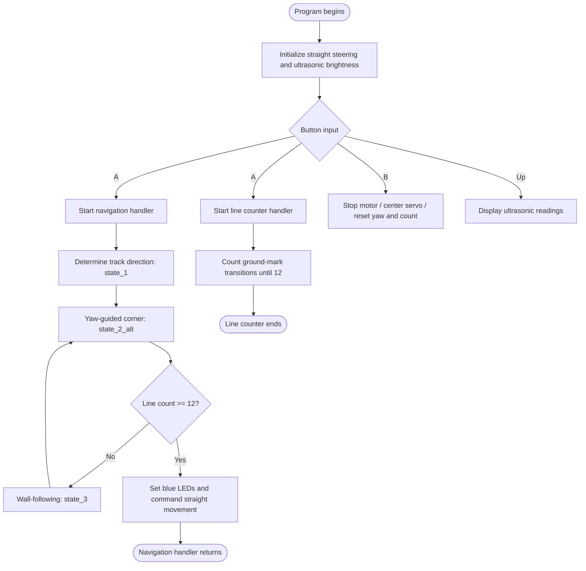
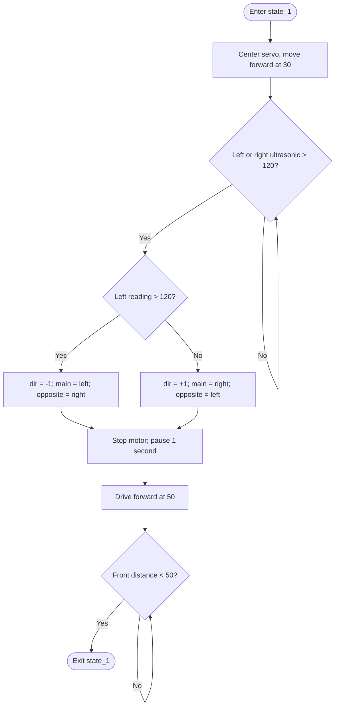
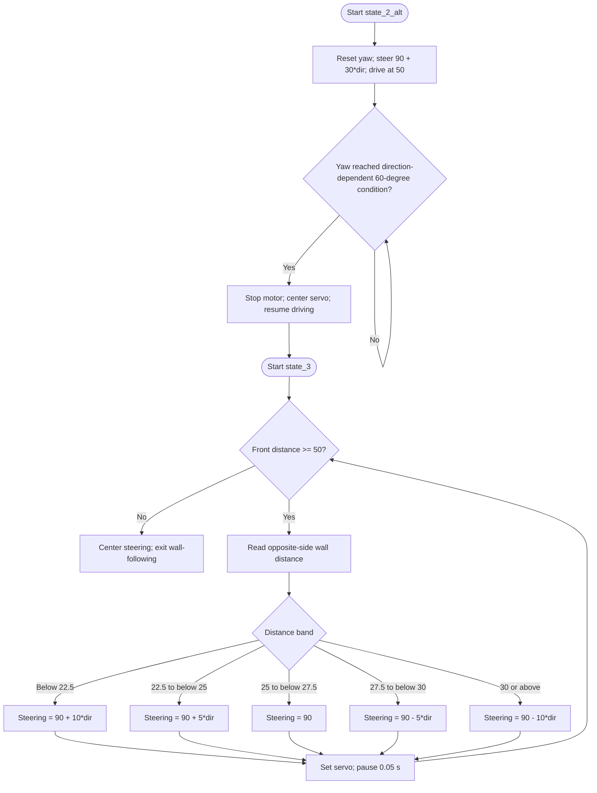
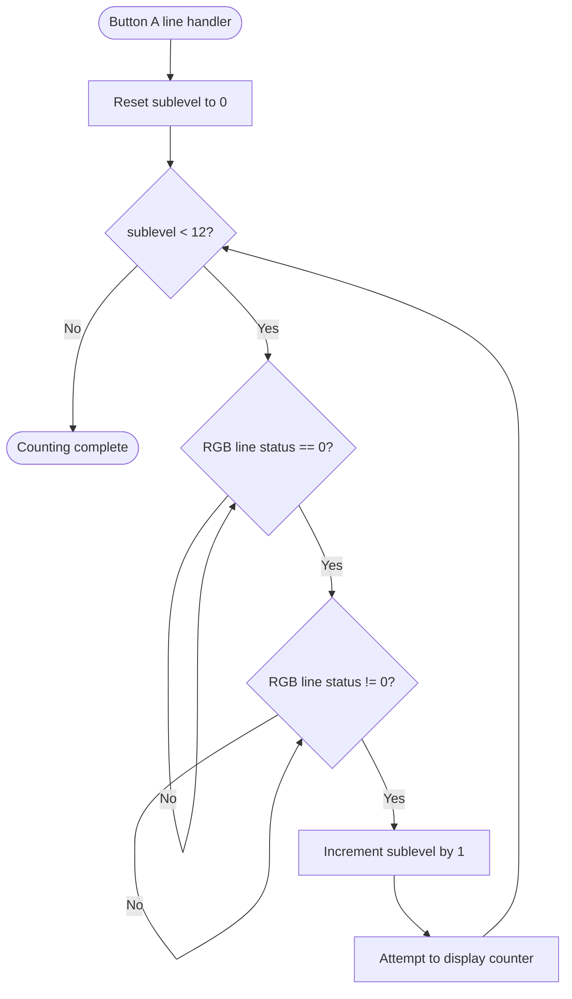
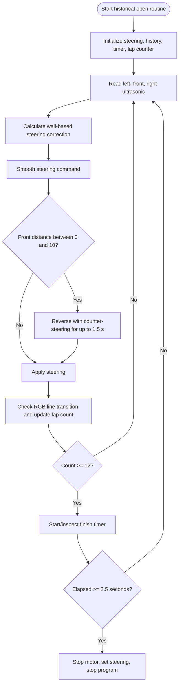
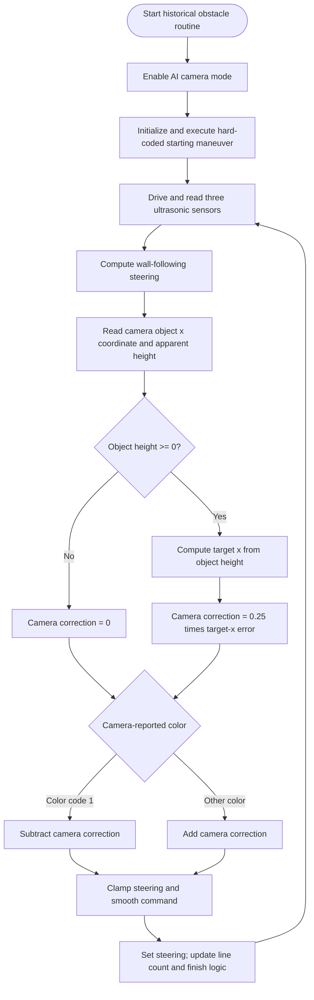
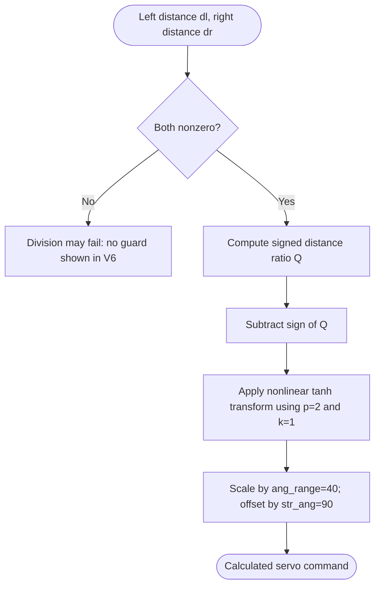

# Downforce Software Flowcharts

[← Software README](README.md) · [← Main README](../README.md)

These flowcharts explain the Python revisions in the project. **V4 is the final physical robot**; V5 and V6 refer to *software revisions*. V6 covers state-driven navigation and lap counting, while the earlier V5 program documents Open and Obstacle Challenge routines.

GitHub renders these Mermaid flowcharts directly in Markdown, so they stay legible and editable without uploading separate pictures.

## 1. Overall program map — Python V6

**Program behavior:** V6 registers separate Button A handlers for navigation and lap counting. Its final navigation branch commands `mbot2.straight(50)` and returns. The source includes an indentation error in `line()`; the flowchart represents the control steps expressed by the code.

## 2. Direction selection — V6 `state_1()`

This is the direction-selection logic and threshold values **as written in V6**. Port mapping in this revision is left=3, front=2, right=1, unlike earlier revisions.

## 3. Corner navigation and wall following — V6

The turn stops when the yaw condition in the `while` statement becomes false. The yaw condition controls when this software turn phase ends. The bands are ultrasonic reading thresholds from the source.

## 4. Blue-marking line counter — V6 `line()`

The two wait phases detect entering and leaving a marking, preventing repeated counts while continuously seeing the same status. The wait loops contain no timeout. The display statements in V6 have an indentation error; the chart shows the line-crossing algorithm.

## 5. Historical Open Challenge — Python V5 `open()`

This is the **Python V5** stopping algorithm, which uses a 2.5-second finishing interval.

## 6. Historical Obstacle Challenge — Python V5 `obst()`

This flowchart summarizes the Python V5 detection-and-steering loop. The V6 program uses a different state-driven navigation structure and has no equivalent Smart Camera obstacle routine.

## 7. Mathematical steering in the V6 source

The zero-reading guard is shown as a **potential error**, not an implemented recovery mechanism. The V6 `calc_angle()` function is called by `state_3_alt()`, which is defined but **not called from its Button A main navigation loop**. The active V6 `state_3()` instead uses fixed distance bands.

---

### How to maintain these diagrams

If your partner changes the robot's software, update the relevant Mermaid blocks from the new verified source. These flowcharts are text-based: on GitHub, select **Edit file** and change the nodes or arrows in `code/flowcharts.md`. Do not relabel a historical algorithm as final V4 behavior without confirming that the actual current program uses it.
