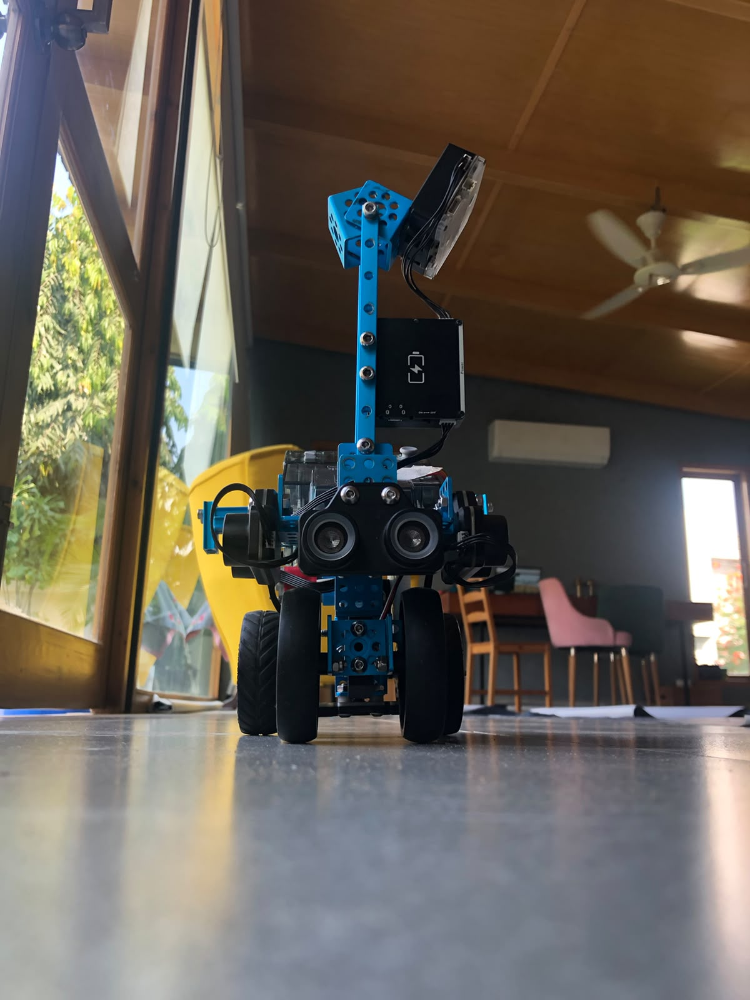

# 9. Components and Mechanical Reconstruction

[← Main README](../README.md)

## Structural bill of materials

The following structural components make up the custom Makeblock V4 chassis.

| Makeblock structural piece | Quantity |
|---|---:|
| 3 × 3 L-Bracket | 6 |
| Bracket U1 | 4 |
| V-Bracket | 3 |
| 3 × 8 L-Bracket | 1 |
| 7 × 9 Plate | 1 |
| 3 × 9 Plate | 3 |
| 1 × 17 Beam | 2 |
| 3 × 22 Beam | 1 |
| 3 × 8 Beam | 1 |
| 3 × 14 Beam | 1 |
| 3 × 4 Beam | 2 |
| **Total structural pieces** | **25** |

## Functional components

- 1 mBot2 Shield/CyberPi controller with integrated rechargeable lithium battery
- 1 Makeblock 180 Optical Encoder Motor
- 1 MS-1.5A steering servo
- 4 wheels, shared rear axle and front pivot assemblies
- 3 Makeblock Ultrasonic Sensor 2 modules
- 1 Makeblock Smart Camera and elevated support
- 1 Makeblock Quad RGB Sensor and rear mounting
- Fasteners, connectors and wiring as shown in the team's physical assembly photographs

## Reconstruction procedure

The assembly guide follows the bottom-up construction approach used for V4.

1. Build the rear-wheel-and-axle subassembly and connect its axle to the encoder motor output.
2. Establish front wheel pivots and steering alignment, with the central servo placed behind and between the front wheels.
3. Connect the servo-driven main linkage to the two wheel linkages. Confirm free, synchronized left/right pivot movement.
4. Connect front and rear assemblies using the structural beams, plates and brackets, then mount the controller above the central steering hardware.
5. Install the ultrasonic sensors in front/left/right orientation, the elevated front camera, and rear downward-facing Quad RGB sensor.
6. Join the rear stabilizer beams and mount the rigid assembly behind the axle, keeping the lowest point approximately 11 cm from the mat.
7. Tighten and inspect fasteners, route wiring away from joints, and check wheel movement throughout the software steering range.

## Key mechanical trade-offs

**Modular versus prebuilt chassis:** The earlier YFROBOT platform provided a convenient base, but constrained geometry and component layout. Makeblock beams enabled a custom arrangement at the cost of more assembly and fastening work.

**Single rear motor versus independently driven wheels:** One shared axle simplified motor control, while inner/outer wheel speed difference during turns can cause friction.

**Low rear stabilizer versus wall clearance:** Added rigid mass helped observed sideways stability, but extending the structure sideways and rearward required mounting above the wall height.
