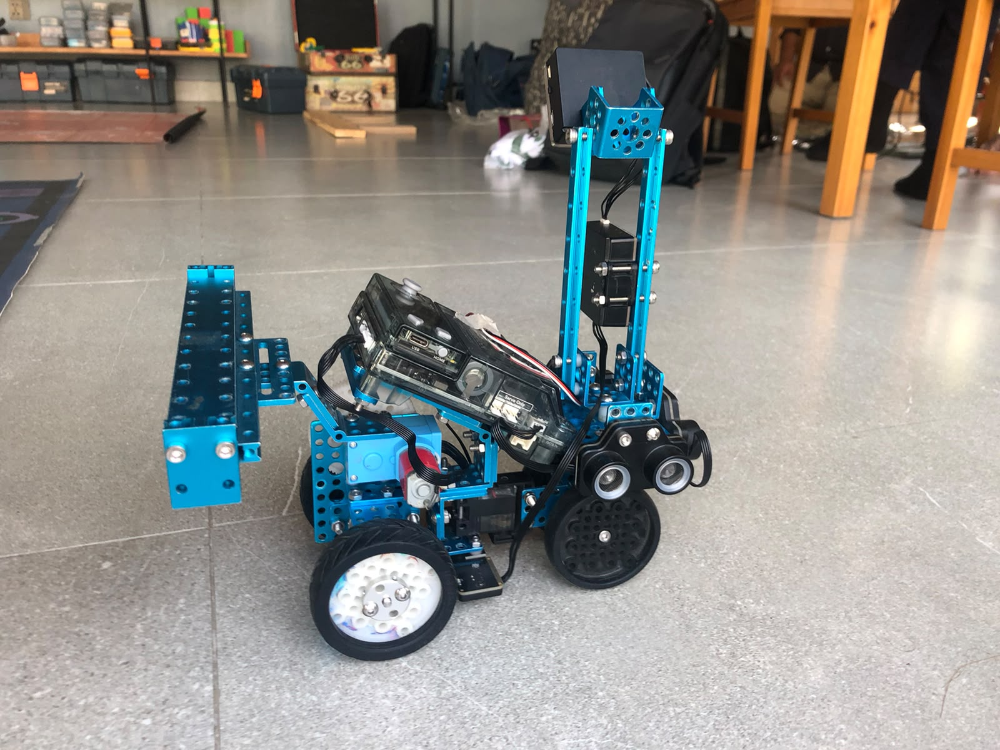
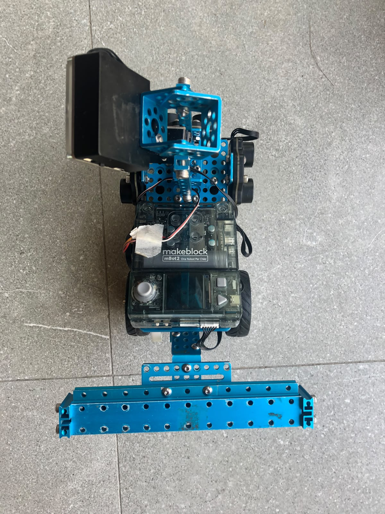

# 6. Challenge Strategies

[← Main README](../README.md)

## Open Challenge

The vehicle follows track boundaries using three ultrasonic sensors. In the team's documented approach, the left and right readings provide steering corrections while the front reading provides information about the approaching end wall. The Quad RGB sensor near the rear counts floor-blue-line crossings for lap progress.

**Performance video:** [Open Challenge run](../media/OPEN_CHALLENGE.mp4).

For lap tracking, the downward-facing sensor records four blue-marking crossings per lap. Three laps correspond to **12 crossings**. The planned finish sequence adds approximately 3–4 seconds of movement after the twelfth crossing. Programming details are covered in the software README.

## Obstacle Challenge

The Smart Camera is used to recognize red and green traffic-sign pillars, while the range sensors maintain awareness of the wall geometry. The earlier Python `WRO26v5.py` includes a camera correction calculated from object horizontal position and height, applied with different sign depending on detected color.

**Design rationale:** Wall-following alone is insufficient when colored obstacles appear in the driving corridor. A camera detects the pillar category; ultrasonic readings continue to inform the track-relative steering demand.

## Parking

Parking is a distinct challenge requirement. The archived programs in this repository focus on navigation, line counting and obstacle handling; no parking sequence is included in the published source files.

## Demonstration and interpretation

Our [Open Challenge video](../media/OPEN_CHALLENGE.mp4) shows the robot navigating the course. The testing chapter explains the mechanical and control decisions that shaped this development.

[Software algorithms, including historical open/obstacle functions →](../code/README.md)
