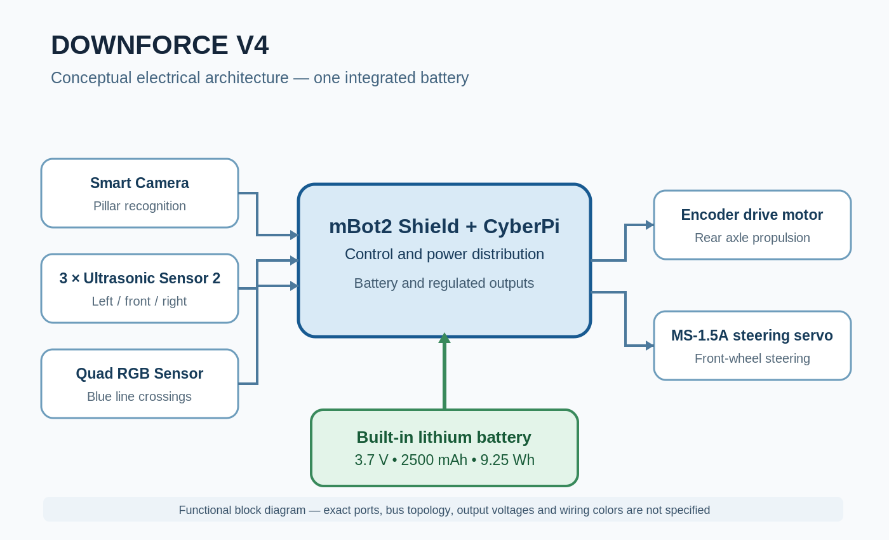
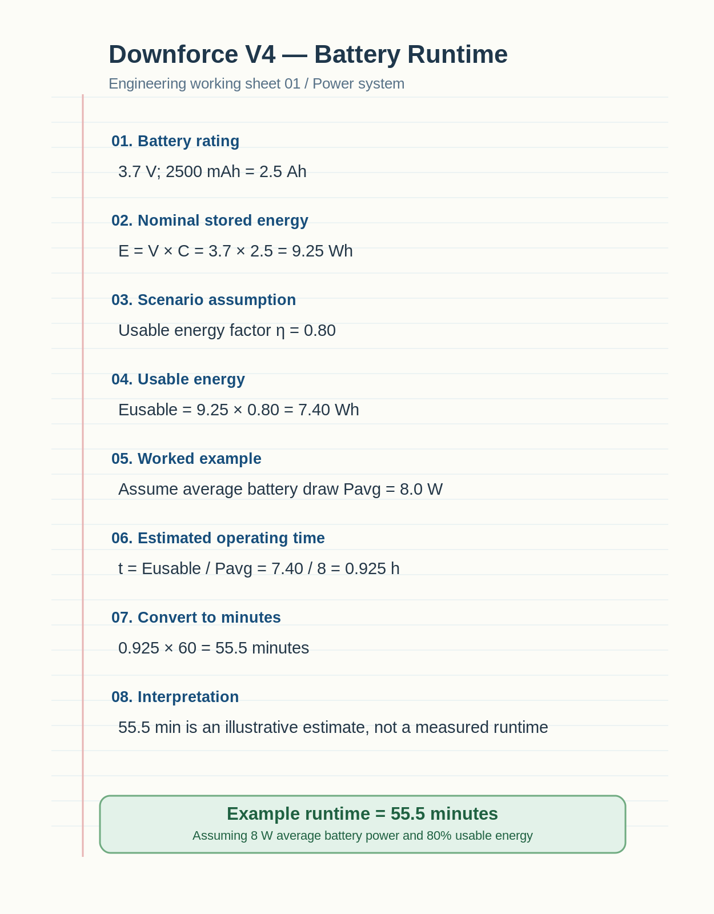

# 4. Power and Electrical Architecture

[← Main README](../README.md)

## 4.1 A single power source in V4

The final V4 uses the **mBot2/CyberPi integrated 3.7 V, 2500 mAh lithium supply** for the entire robot. The steering servo, encoder drive motor, three ultrasonic sensors, Quad RGB sensor and Smart Camera all receive power through the mBot2 system. The Smart Camera stays on even during the Open Challenge, where its obstacle-recognition capability is not used.

*Functional block diagram: connection and power roles only, not an asserted port-by-port schematic.*

## 4.2 Why we changed the architecture

In the earlier YFROBOT-based versions, the steering servo had an external **6 V supply made from four AA batteries**, with a common ground joining the external supply and the controller signal system. The original repository records overheating and control problems with an earlier inadequate power arrangement. V4 removed the external pack and used the integrated mBot2 distribution instead.

This simplified charging, wiring and packaging. The trade-off is a shared battery feeding actuators and sensing hardware, so simultaneous steering/drive peaks can affect power demand.

## 4.3 Electrical parts

| Item | Number | Role |
|---|---:|---|
| mBot2 Shield/CyberPi | 1 | Main control, integrated power distribution |
| 180 Optical Encoder Motor | 1 | Drives shared rear axle |
| MS-1.5A servo | 1 | Front steering |
| Ultrasonic Sensor 2 | 3 | Left, front, right wall ranges |
| Makeblock Smart Camera | 1 | Red/green pillar sensing |
| Quad RGB sensor | 1 | Ground-blue marking detection |
| Integrated rechargeable lithium battery | 1 | Sole energy source, 3.7 V, 2500 mAh |

## 4.4 Nominal battery energy

\[
2500\,\mathrm{mAh}=2.5\,\mathrm{Ah}
\]
\[
E=V\times C=3.7\times2.5=\boxed{9.25\,\mathrm{Wh}}
\]

*Power-budget calculation using nominal battery energy and modeled average electrical loads.*

## 4.5 Power-consumption planning model

Battery endurance depends on the load during the run. The model below uses nominal battery capacity and a representative set of average electrical loads to evaluate power demand.

| Load | Assumed average power (W) | Basis |
|---|---:|---|
| mBot2 processing and power electronics | 1.20 | Modeled load |
| Rear encoder motor | 3.00 | Representative load model; changes with motor demand |
| Steering servo | 0.80 | Average across steering and holding phases |
| Three ultrasonic sensors | 0.45 | 0.15 W per unit in the load model |
| Smart Camera | 1.10 | Midpoint of 0.9–1.3 W cited in original Downforce README |
| Quad RGB sensor | 0.20 | Modeled load |
| **Subtotal** | **6.75** | Modeled component-side load |

Using an **85% assumed power-distribution efficiency**:

\[
P_{battery}=\frac{6.75}{0.85}=\boxed{7.94\,\mathrm{W}}
\]

The motor's no-load/loaded current and the servo's stall current should not be mistaken for continuous average current. Device rails may operate at different voltages, so average energy accounting is more appropriate than simply summing all component currents.

## 4.6 Theoretical runtime

Using an **80% usable-energy factor**:

\[
E_{usable}=0.80\times9.25=7.40\,\mathrm{Wh}
\]
\[
t=\frac{E_{usable}}{P_{battery}}=\frac{7.40}{7.94}=0.932\,\mathrm{hours}\approx\boxed{55.9\,\mathrm{minutes}}
\]

| Average battery input power | Runtime with 7.40 Wh usable |
|---|---:|
| 5 W | 88.8 min |
| 6 W | 74.0 min |
| 8 W | 55.5 min |
| 10 W | 44.4 min |
| 12 W | 37.0 min |

**Engineering interpretation:** Both challenges keep the camera powered, but the motors and servo experience different motion patterns. Turning, speed regulation, surface drag, camera activity and battery condition affect actual runtime. The values above describe theoretical runtime under the stated power and efficiency assumptions.

## 4.7 Power reliability considerations

- A common integrated source simplifies power management but needs enough instantaneous current for motor and servo peaks.
- Servo stall current is a short-duration worst case, not typical continuous demand.
- Cable strain relief is particularly important around the front linkage and elevated camera mounting.
- Charge state affects voltage availability and motor response during repeated runs.

## 4.8 Data sources

- [Makeblock mBot2 Neo Shield support](https://support.makeblock.com/hc/en-us/articles/12739821665687-About-mBot2-Neo-Shield)
- [Makeblock Ultrasonic Sensor 2](https://support.makeblock.com/hc/en-us/articles/12403842075543-About-Ultrasonic-Sensor-2)
- [Makeblock Quad RGB sensor](https://support.makeblock.com/hc/en-us/articles/12545566572695-About-Quad-RGB-Sensor)
- [Makeblock Smart Camera product specifications](https://botland.store/accessories-for-educational-robots/21197-makeblock-smart-camera-6928819510616.html)
