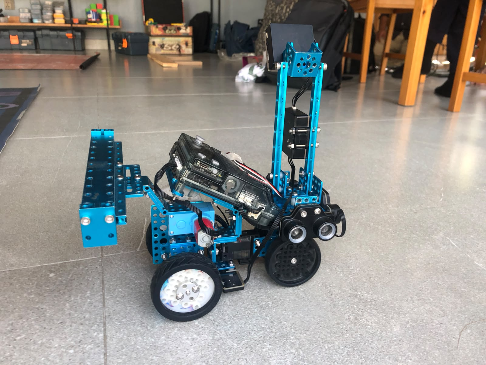
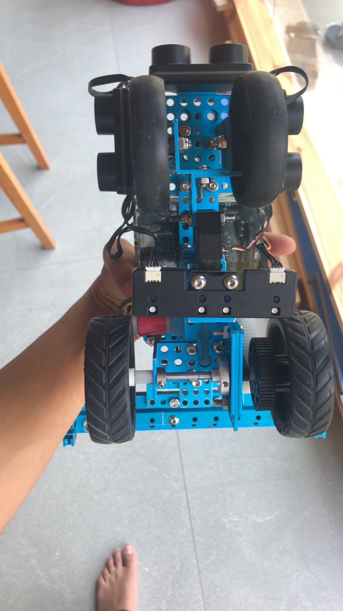
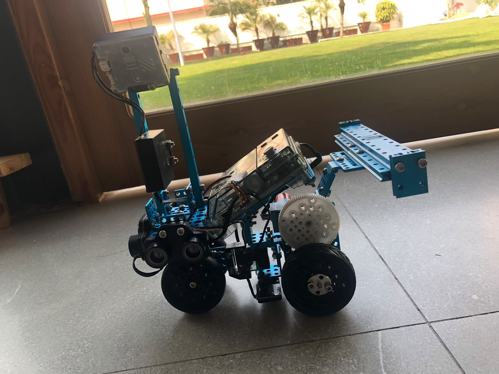
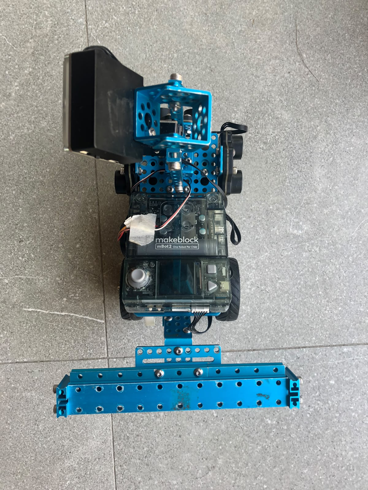
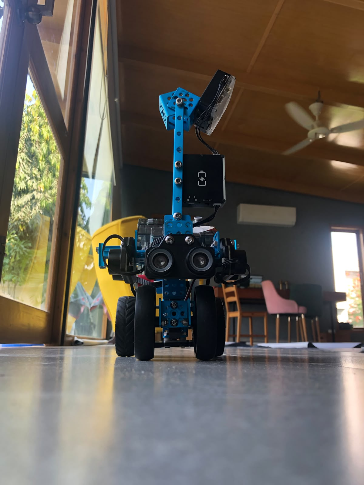

# 3. Mobility and Mechanical Design — Final V4

[← Main README](../README.md)

## 3.1 Design approach

After Nationals, we moved from the YFROBOT chassis to custom Makeblock construction because the original robot had difficulty navigating obstacles within the available clearance. V4 was built around the wheel assemblies, then extended upwards with structural beams, brackets, and the controller mounting system. Modularity made the design adjustable and repairable without custom-machined components.

## 3.2 Dimensions and mechanical parameters

| Parameter | V4 |
|---|---:|
| Overall length | Approximately 25 cm |
| Width | Approximately 20 cm |
| Total height including elevated camera | Approximately 22.5 cm |
| Total mass including spoiler | 1.10 kg |
| Rear wheel diameter | 4 in = 10.16 cm |
| Rear wheel width | 1 in = 2.54 cm |
| Wheelbase | Approximately 8–9 in; midpoint 21.6 cm |
| Front wheel track | Approximately 8.5 cm |
| Rear wheel track | Approximately 12 cm |
| Servo / front wheel reported angular range | About ±90° |

## 3.3 Rear-wheel propulsion

The **Makeblock 180 Optical Encoder Motor** is connected directly at its output to the common rear axle. Both rear wheels are driven by the same motor and remain aligned with the car body during steering. The motor has an internal reduction mechanism, although the external connection to the shared axle does not use an additional gearing stage.

This approach requires only one drive actuator and simplifies propulsion control. A shared axle without a differential can create wheel scrub during tight turns because inside and outside wheels travel different distances.

### Wheel-rotation and theoretical vehicle speed

With a 4-inch wheel diameter:

\[
D=4\times2.54=10.16\,\mathrm{cm}=0.1016\,\mathrm{m}
\]
\[
C=\pi D=\pi\times0.1016\approx0.3192\,\mathrm{m}
\]

Using the published *motor output-shaft* no-load speed of 350 rpm and rated-load speed of 178 rpm, with wheel speed assumed equal to output-shaft speed:

\[
v=C\frac{N}{60}\times3.6
\]

| Condition | Theoretical speed |
|---|---:|
| At 178 rpm rated-load motor output | 3.41 km/h |
| At 350 rpm no-load motor output | 6.70 km/h |

These are idealized wheel-speed calculations, not measured run speeds. Drive loading and rolling slip affect achieved speed.

## 3.4 Front-wheel steering: three-linkage system

V4 uses a **single MS-1.5A servo**, mounted near the longitudinal centreline, behind the front wheels and underneath the controller. The servo actuates a **central metal linkage**, which travels left and right and connects to **two side linkages**, each attached to one front wheel. The front wheels pivot in the commanded direction; the rear axle does not steer.

**Why this arrangement?** One actuator coordinates both steering wheels, the linkage remains compact inside the custom chassis, and replaceable metal pieces and screw/nut fasteners permit alignment changes without rebuilding the entire vehicle. Fasteners were tightened securely using a drill. The mechanism stayed stable in the team's reported tests.

The V3 steering range was reported as 30° left and 40° right; the V4 system was reported to reach approximately 90° on either side. **Steering angle is not turning radius.** At extreme steering angles, a simple rolling bicycle-model calculation is inadequate for this actual car, especially with a solid rear axle. Consequently we do not claim a numerical minimum turning radius from 90° alone.

## 3.5 Rear stabilizer (team term: 'spoiler')

When V4 executed full-steering turns above roughly 2 km/h, it could tip sideways. The team added a rigid, side-to-side rear metal assembly composed of multiple Makeblock beams joined by screw-and-nut fasteners. The structure extends behind the rear wheels and is supported low while remaining above the competition walls.

| Stabilizer attribute | Description |
|---|---|
| Span, left to right | 20 cm |
| Front-to-back depth | 2.5 cm |
| Height of assembly | 2.5 cm |
| Lowest part above mat | Approximately 11 cm |
| Upper part above mat | Approximately 13.5 cm |
| Mass | Approximately 200 g |
| Attachment | Rigid Makeblock beam-and-screw assembly behind rear axle |

**Why here?** The team had to balance the position of added rear mass against clearance around the inner and outer walls. Screw-fastened beams allow a rigid, consistent structure; moving ballast would make balance less predictable. The mounting height was chosen to clear the walls during level operation, and the span extends laterally behind the rear wheels.

### Clearance calculation

With a 10 cm nominal wall height and the stabilizer's lowest point 11 cm above the mat:

\[
C_{static}=11-10=\boxed{1\,\mathrm{cm}=10\,\mathrm{mm}}
\]

This is the **level-vehicle vertical gap**. Sideways leaning can reduce effective clearance during a turn.

### Mass fraction and trade-off

\[
\frac{m_{spoiler}}{m_{robot}}\times100
=\frac{0.20}{1.10}\times100=\boxed{18.2\%}
\]

The assembly accounts for around 18% of total mass. Rear placement changes front/rear load distribution. A lower centre of mass generally improves lateral stability, while the overall effect depends on the complete mass distribution. The observed improvement is discussed in terms of weight placement rather than aerodynamic downforce.

### Reported cornering improvement

The team observed sideways tipping during full-steering turning above approximately **2 km/h** before the modification and reported stable turning at approximately **4 km/h** afterward.

\[
\%\Delta v=\frac{4-2}{2}\times100=\boxed{100\%}
\]

At the *same turn radius*, lateral acceleration obeys \(a=v^2/R\). Doubling speed gives a theoretical factor of four in lateral acceleration demand. This relationship explains why increases in speed place much greater demands on cornering stability.

## 3.6 Mass comparison and compliance

| Mass analysis | Result |
|---|---:|
| V3 mass | 0.91 kg |
| V4 mass including rear stabilizer | 1.10 kg |
| Difference | 0.19 kg = 190 g |
| Relative increase | (0.19 / 0.91) × 100 = **20.9%** |
| Remaining allowance against 1.50 kg maximum | **0.40 kg** |

The 190 g difference reflects the *whole-robot mass change*, not a direct before/after measurement of the spoiler alone.

## 3.7 Mechanical construction overview

The following is a **reconstruction-oriented sequence** for the final arrangement, consistent with the team's bottom-up build method.

1. Establish the rear axle and single motor connection, checking free wheel rotation.
2. Assemble the front-wheel pivots, centrally mounted servo and three connected steering linkages.
3. Join the wheel assemblies with Makeblock beams, brackets and plates to establish wheelbase.
4. Mount the angled central controller assembly above the steering linkage and route cables clear of moving joints.
5. Mount left/front/right ultrasonic modules and the elevated forward Smart Camera.
6. Attach the rear metal stabilizer behind the axle with screw-and-nut fasteners and maintain wall clearance.
7. Inspect wheel alignment, steering motion, fasteners, cables and ground clearances.

[See structural part quantities and assembly resources →](build-and-components.md)
