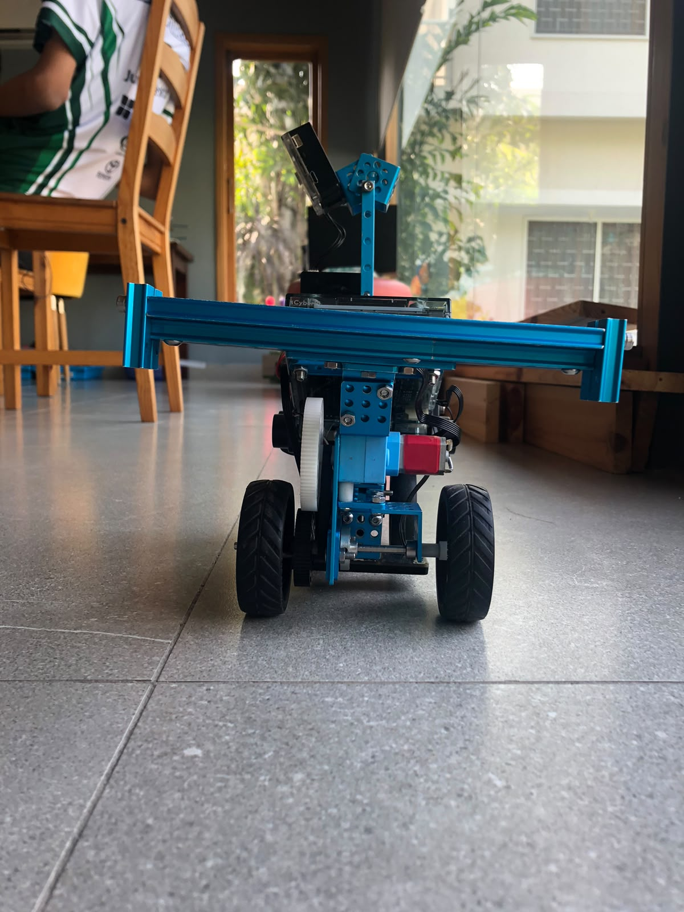

# 1. Project Overview and Design Objectives

[← Main README](../README.md)

## The challenge

In WRO Future Engineers 2026, the robot must move autonomously through a walled course, turn around corners, respond to traffic-sign pillars in the Obstacle Challenge, and finish its journey. A reliable solution requires mechanical geometry, sensing, actuation and software to work together.

## Our engineering priorities

1. **Maneuverability:** move from the restricted YFROBOT steering arrangement to a smaller-radius custom chassis.
2. **Reliable distance sensing:** maintain a front/left/right ultrasonic geometry that is meaningful to the wall-following controller.
3. **Responsive pillar detection:** elevate the Smart Camera at the front to see red and green signs earlier.
4. **Stable turning:** resist sideways tipping without colliding with the wall around a turn.
5. **Reproducibility:** use replaceable Makeblock parts and documented code, images and assembly notes.

## Final robot at a glance

| System | Design |
|---|---|
| Physical version | V4 |
| Structural design | Custom Makeblock beam and bracket chassis |
| Drive | Single rear encoder motor, direct output connection to shared rear axle |
| Steering | One MS-1.5A servo, lateral main linkage and left/right side linkages |
| Sensor suite | Three Ultrasonic Sensor 2 modules, one Smart Camera, one Quad RGB sensor |
| Controller/power | mBot2/CyberPi system, integrated 3.7 V 2500 mAh lithium battery |
| Mass | 1.10 kg including rear metal stabilizer |
| Approx. dimensions | 25 cm long × 20 cm wide × 22.5 cm tall (including camera) |
| Rear wheels | 4-inch nominal diameter; 1-inch width |
| Wheelbase | Approximately 8–9 inches (midpoint used for examples: 21.6 cm) |

*The elevation of the Smart Camera creates a vision-versus-height trade-off, while the rear stabilizer addresses the separate stability problem experienced in sharp turns.*
