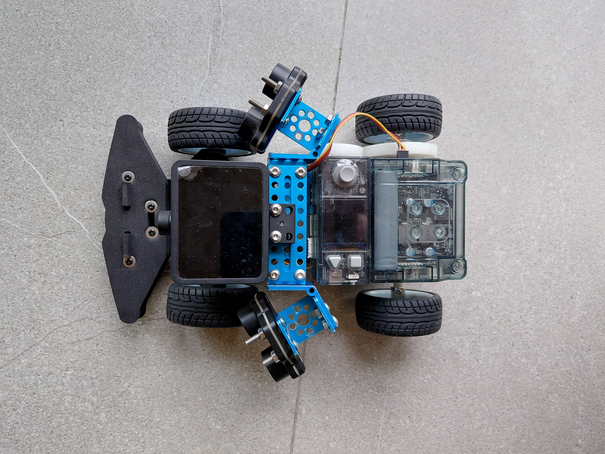
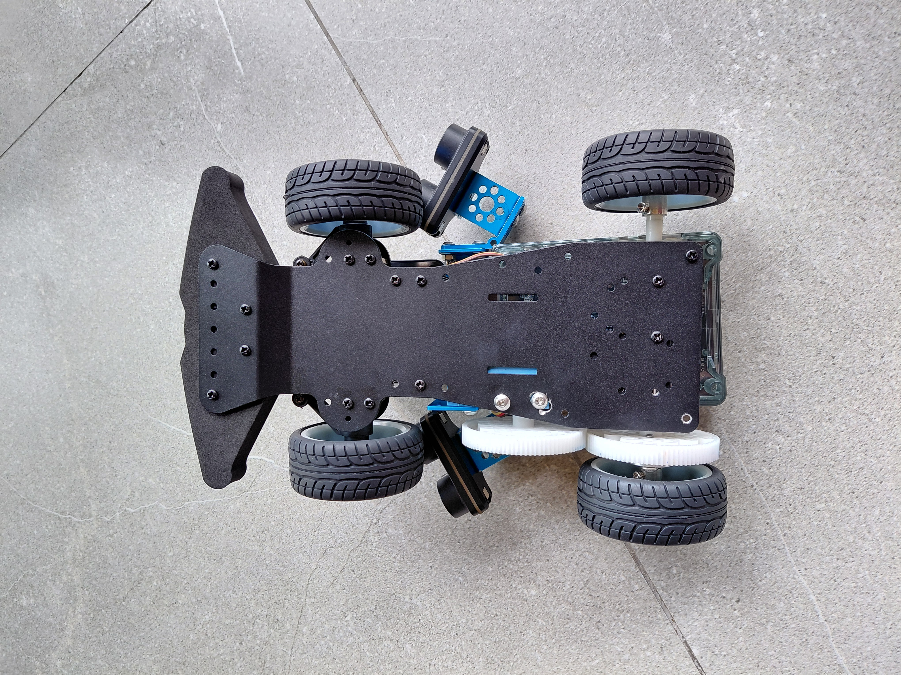
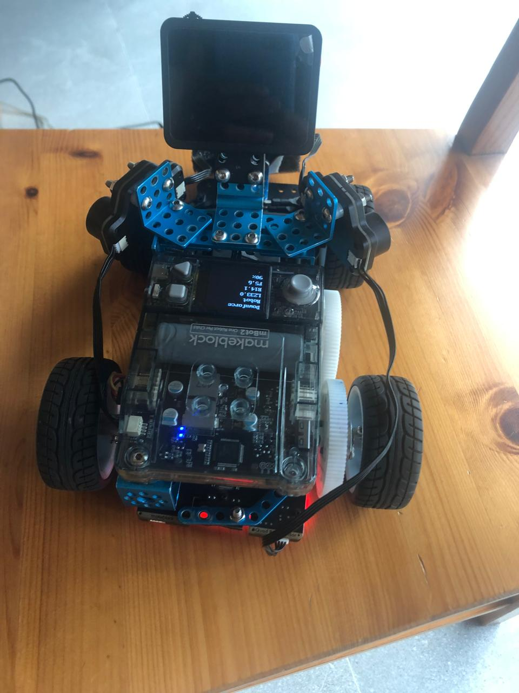
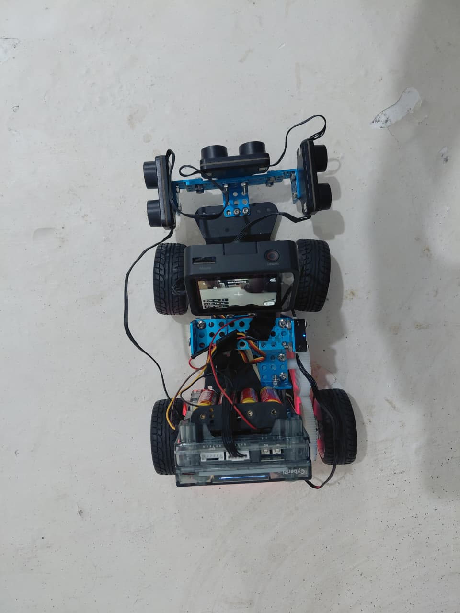
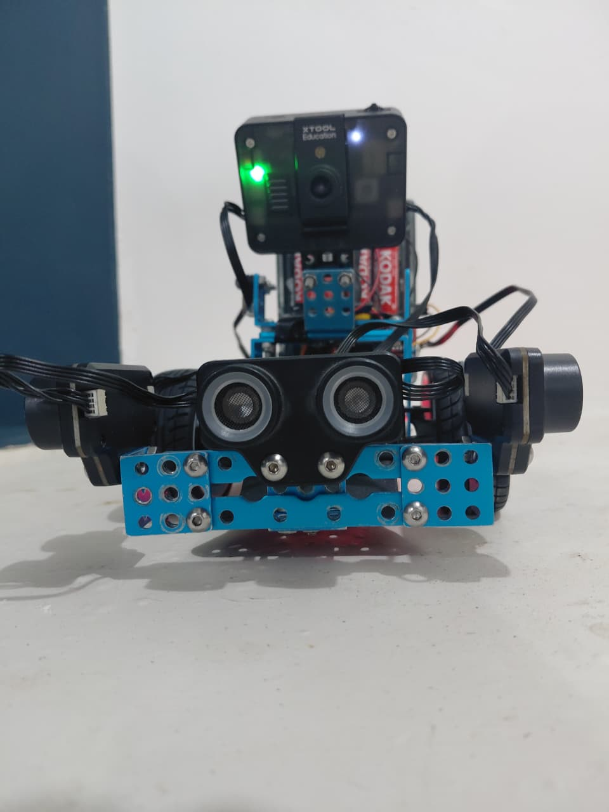
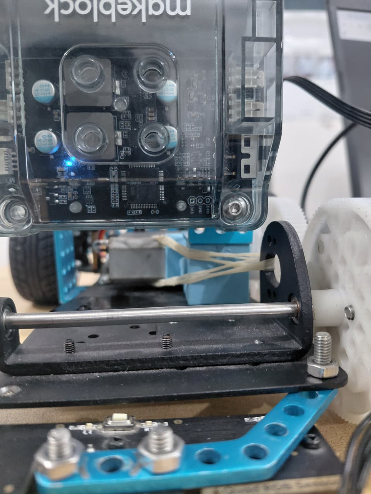
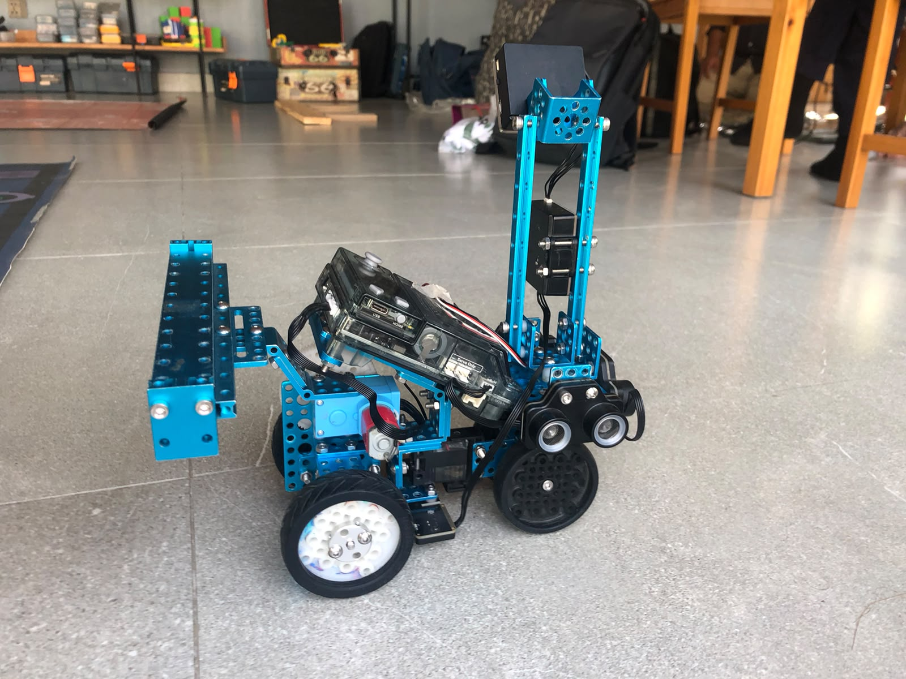
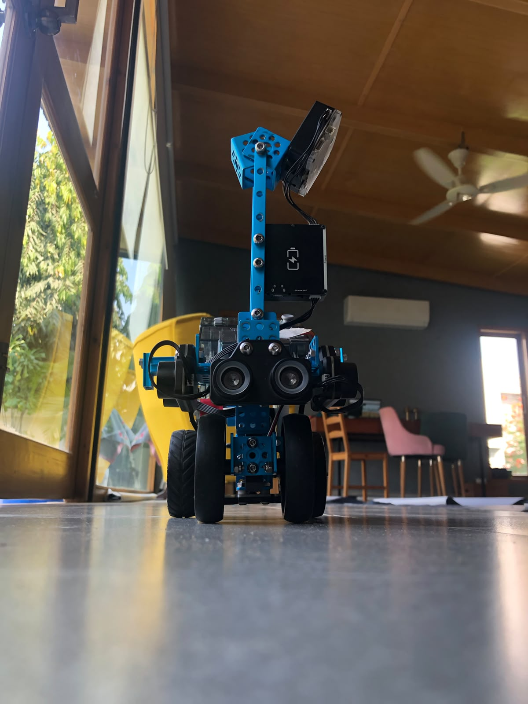

# 2. Robot Evolution — From V1 to V4

[← Main README](../README.md)

## Why our robot changed

Physical versions V1–V3 used a YFROBOT car-type steering chassis. These experiments gave the team a foundation in control and sensor positioning. **V3 was the robot used at Nationals.** Following Nationals, the team concluded that the platform's width and turning radius were limiting obstacle navigation, even as software developed. Physical **V4** was therefore designed from Makeblock metal structural components.

## V1 — First YFROBOT-based prototype

The initial vehicle combined a rear-driven axle, servo-based Ackermann steering, mBot2 processing and wall-distance sensing. The main objective was to achieve basic autonomous navigation and understand how the steering system responded to ultrasonic measurements.

*Early mechanical arrangement on the prebuilt chassis.*

*Early drivetrain and underside arrangement.*

## V2 — Earlier turn detection through sensor placement

The robot began turning too late as it approached the walls and corners. We experimented with angling the side ultrasonic sensors forward, to observe approaching geometry earlier. While conceptually this could provide earlier warning, the angled readings were frequently anomalous for our navigation method.

*V2: experimental forward-angled side sensing.*

## V3 — Nationals robot

In V3 we repositioned the side ultrasonic sensors toward the front, perpendicular to the front-facing ultrasonic sensor. The three-direction arrangement was more consistent with the controller's left, front and right range interpretation. V3 retained the prebuilt chassis and was used at Nationals.

One practical drivetrain problem was separation between a motor gear and an axle gear on the older chassis. Rubber bands were used as a retention workaround to keep them engaged.

**Our key Nationals lesson:** The YFROBOT platform was too bulky and its turning behavior limited clearance around traffic-sign pillars. The previous AI camera was also reported to update too slowly for obstacle response. These problems were better addressed by mechanical redesign and camera replacement than by tuning steering code alone.

## V4 — Final custom Makeblock vehicle

V4 replaced the prebuilt platform with an adjustable Makeblock beam, bracket and plate construction. This changed the front-wheel steering geometry and gave us more freedom to place the servo, rear drive, controller and sensors. The controller remained close to the center, the Smart Camera was mounted high at the front, and a rigid rear stabilizer was added following sideways tipping at speed.

<table><tr><td width="50%"> <em>V4 final robot</em></td><td width="50%"> <em>Second view of V4</em></td></tr></table>

### Key differences

| Attribute | V3 | V4 |
|---|---|---|
| Physical platform | YFROBOT | Custom Makeblock assembly |
| Steering layout | Ackermann, constrained range | Servo-driven 3-linkage front-wheel steering |
| Reported left/right steering range | 30° / 40° | 90° / 90° |
| Robot mass | 0.91 kg | 1.10 kg including stabilizer |
| Camera | XTOOL Education AI Camera 2.0 | Makeblock Smart Camera |
| Servo power | Separate 6 V AA supply | Through mBot2 integrated system |
| Development focus | Reliable wall readings, Nationals performance | Maneuverability, vision response, high-speed stability |

**Hardware versions versus code versions:** `WRO26v5.py` and `WRO26v6.py` are code revisions. There is no physical robot V5 or V6.
