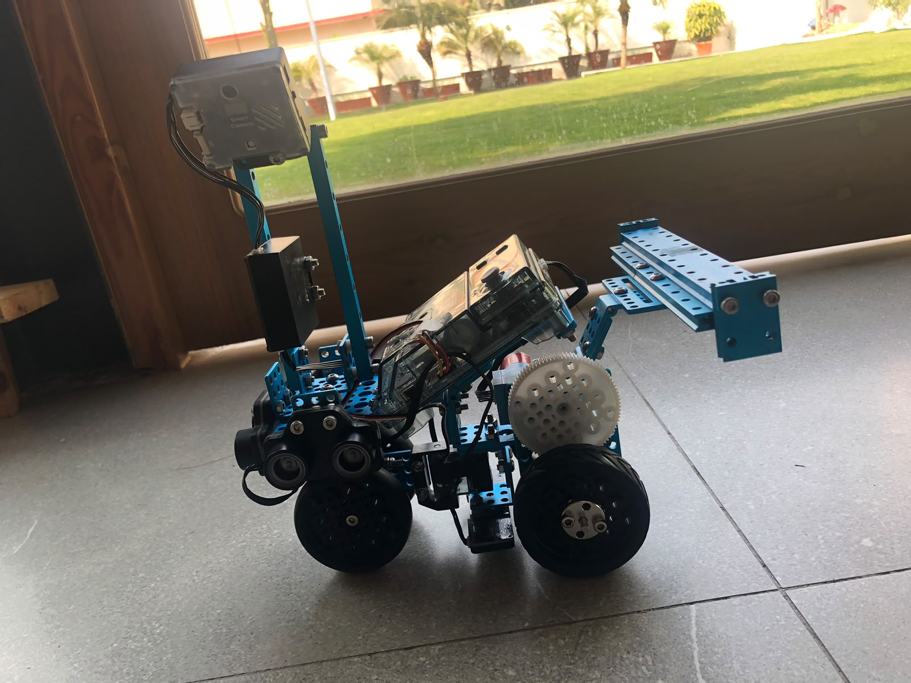
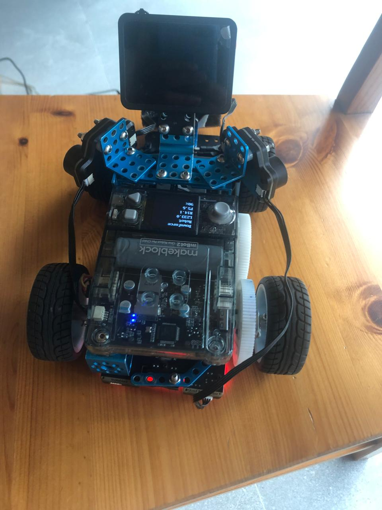
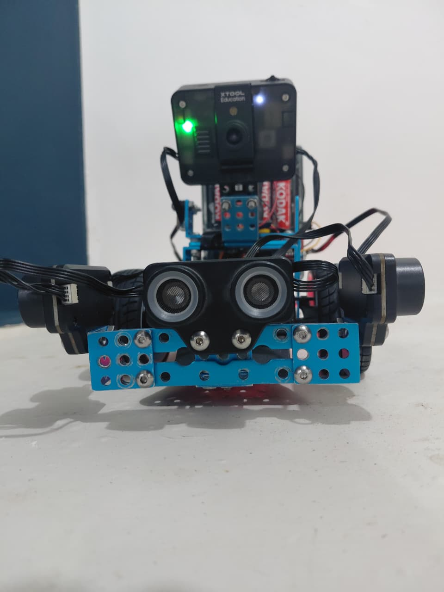
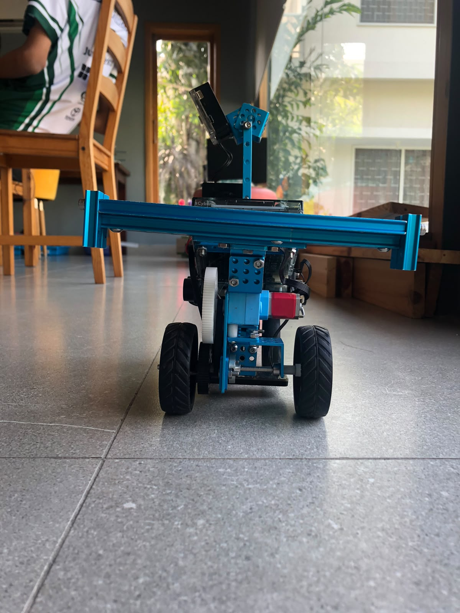

# 5. Sensor Architecture and Mounting Decisions

[← Main README](../README.md)

## Sensor layout

V4 combines three complementary sensing methods: ultrasonic ranging for track geometry, camera color recognition for pillars, and a downward RGB sensor for lap progress.

| Device | Location | Role |
|---|---|---|
| Front ultrasonic | Front-facing | Distance to approaching wall |
| Left ultrasonic | Side-facing | Left-wall distance |
| Right ultrasonic | Side-facing | Right-wall distance |
| Smart Camera | Front, elevated | Detects red and green pillars in Obstacle Challenge only |
| Quad RGB line sensor | Near rear wheels, pointing down | Blue-line crossings and lap count in both challenges |

## Why the ultrasonic positions changed

In V2, the two side-facing ultrasonic sensors were angled forward to detect approaching corners earlier. This sometimes gave anomalous measurements because the angle changed what surfaces were being measured. In V3, the side sensors were moved to a perpendicular left/front/right arrangement. V4 retained the three-sided concept so the navigation controller receives clearly oriented range information.

<table><tr><td width="50%"> <em>V2: angled sensor experiment</em></td><td width="50%"> <em>V3: orthogonal three-direction arrangement</em></td></tr></table>

## Why the Smart Camera is elevated

The earlier AI camera was reported to provide obstacle-recognition updates too slowly at Nationals. For V4, the team adopted the Makeblock Smart Camera and mounted it high and forward to give it a less obstructed view of approaching red/green pillars. Its role is **obstacle sensing**, not ordinary wall following. This choice trades additional height and mounting complexity for earlier visual access to traffic signs.

The original repository lists a 640 × 480 camera resolution, 65° view angle, 60 fps and 0.25–1.2 m recognition range as published specifications. Frame rate is a device capability, not a measurement of end-to-end obstacle response time.

## Why the Quad RGB sensor is at the rear

The Quad RGB sensor points toward the track surface near the rear wheels. There are **four blue markings per lap**, so the three-lap target is **12 crossings**. The rear position lets the front of the car clear a marking before the crossing event is read, and separates the sensor from the front steering linkages.

\[
4\,\mathrm{marks/lap}\times3\,\mathrm{laps}=\boxed{12\,\mathrm{crossings}}
\]

After reaching 12 crossings, the team's described operational sequence continues for approximately 3–4 seconds before stopping. Earlier source files implement different stopping behavior; the final version must use the actual selected program. In the code chapter we explain how edge detection avoids double counts.

## Sensor accuracy and limitations

The team's original Ultrasonic Sensor 2 table lists a 5–300 cm sensing range and approximately ±5% output error; 300 can represent out-of-range returns. Distance estimates can vary with wall angle, reflections and mounting geometry. Thus the software should distinguish usable samples from error returns and avoid aggressive control from isolated readings.

[Read software sensor-processing implementations →](../code/README.md)
