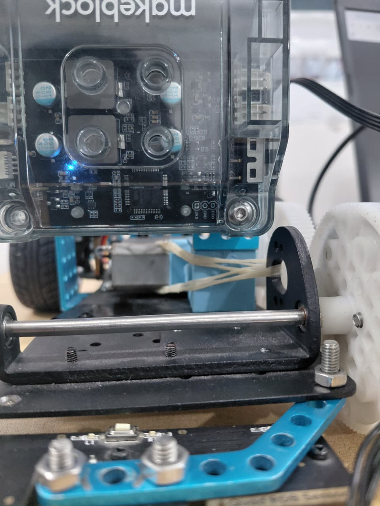

# 8. Testing, Problems, and Engineering Decisions

[← Main README](../README.md)

This record links observable problems with the redesign or code changes that followed. It combines the original repository's development notes with the team's later account of V4.

| Problem | Design decision | Engineering logic / result |
|---|---|---|
| Gear separation between drive motor and axle gears on YFROBOT platform | Rubber-band retention workaround | Improved physical gear engagement during early iterations |
| Underpowered/overheating steering servo on earlier configuration | Separate 6 V AA supply and common electrical ground | Isolated servo load from the lower-voltage controller supply on early chassis |
| Sudden maximum-speed starts and stops causing skidding | Acceleration/deceleration in mBlock trials | Controlled transitions reduced a source of yaw error |
| Steering overcorrected and produced jerky movements | Cubed nonlinear sigmoid response | Reduced aggressive correction for small input errors |
| Corners detected too late | Tilted side ultrasonic sensors toward the front in V2 | Earlier view of some geometry, but frequent anomalous readings |
| Anomalous angled ultrasonic readings | Perpendicular three-direction layout from V3 onward | Better-aligned readings for left/front/right wall sensing |
| V3 bulky chassis and wide turning path | Custom Makeblock platform with different steering linkage for V4 | More flexibility in steering geometry and component placement |
| Old camera updated too slowly for obstacles | Makeblock Smart Camera raised to front of V4 | Aim: earlier and more responsive pillar recognition |
| V4 tipped sideways in full-steering turns above roughly 2 km/h | Rigid ~200 g rear metal stabilizer positioned behind axle | Team reports stable turns at about 4 km/h afterward |
| Older steering values fluctuated | Gaussian-weighted history in archived Python V4/V5 | Smoother commanded steering sequence |

## Quantified comparisons

### Mass

\[
\frac{1.10-0.91}{0.91}\times100=\boxed{20.9\%\ increase}
\]

### Turning stability

Before the rear stabilizer, the robot tipped sideways during full-steering turns above approximately 2 km/h. Afterward, it handled the maneuver at approximately 4 km/h: a **100% increase in the observed stable-turning speed**.

### Power

Single V4 lithium power source: 3.7 V × 2.5 Ah = **9.25 Wh** nominal battery energy. [Detailed scenarios](electrical-and-power.md).

## Performance media

[Open Challenge recording](../media/OPEN_CHALLENGE.mp4)

Performance is documented through the Open Challenge video and the engineering observations recorded throughout this repository. Key evaluation measures include course direction, blue-line crossings, collisions, completion time and steering response.

## Engineering evaluation criteria

We evaluated the vehicle around cornering stability, wall clearance, sensing responsiveness, steering behavior and repeatability across track sections. These criteria connect the mechanical modifications to the robot’s navigation performance.
